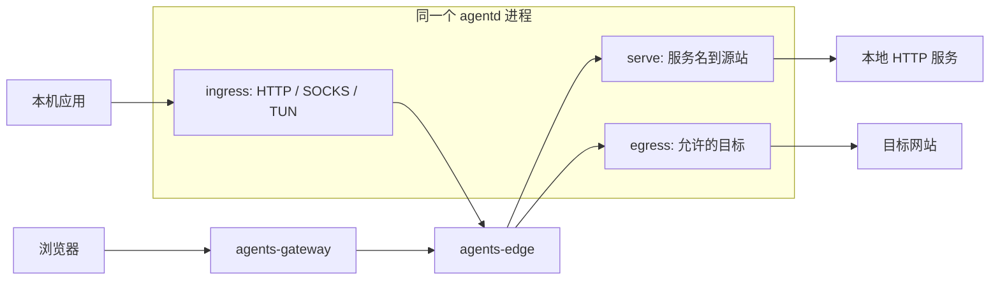

# agentd 本地配置与三角色模型

状态：三角色配置解析、XHTTP packet-up、HTTP/SOCKS、Serve/Egress，以及 agents 注册/批准与配置轮询已实现；其余内容保留为目标规范。当前范围以 [运行说明](../README.md) 和 [本地联调](https://github.com/Bit-Precise/agents/blob/main/docs/local-development.md) 为准，TUN、WSS、agentd Device Flow 与多节点仍未交付。agents Console 的上游 OIDC 已实现。完整示例见 [config.yaml](../examples/agentd/config.yaml)，总体架构见 [架构方案](agents-agentd-architecture.md)。

实际接入为 `agentd enroll --config FILE --key-file PRIVATE_KEY_FILE`，批准后 `agentd run --config FILE`。本机 HTTP 联调显式设置 `transport.allowHTTP: true` 且 instance/endpoint 都用 loopback；生产使用 HTTPS 与可选 `caFile`。见 [local.yaml](../examples/agentd/local.yaml)。凭据与轮询状态不放入 YAML。

2026-10-18 目标身份修订见 [User/SA 与 Hydra Device Flow](https://github.com/Bit-Precise/agents/blob/main/docs/identity-and-device-flow.md)：一个 profile 固定一个 Workspace 和一个 User/SA 主体，三种运行角色共享该主体。拟议 `agentd login --config FILE` 使用标准 Device Flow，在浏览器选择 Workspace/本人或 SA，取得限定用途的 AT 后换取独立设备凭据；`enroll --key-file` 保留为 SA 无人值守路径。SA 固定属于一个 Workspace，选择与管理要求 maintainer+。这些命令/模型增量尚未实现。

本地 YAML 不保存 OAuth device_code、AT 或共享 client secret；配置中的 Workspace 只是与授权结果核对的提示，不能通过编辑 YAML 更换主体。选中 Workspace 后，CLI 应保存/核对当前 profile 的 Workspace 和私有身份；与已有 profile 不符时要求显式新建隔离 profile，不能覆盖其凭据。

**1. 同一进程可以同时担任三种角色**

`config.yaml` 分别配置 `ingress`、`serve`、`egress`，不设置互斥的全局 `mode`，也不维护第二份容易冲突的 `roles` 列表。有效角色直接由三个区块的 `enabled` 推导。每个区块可独立开启或关闭，支持三者的所有非空组合；全部关闭时只保留管理/注册状态，不接受业务。

| 角色 | 流量方向 | 本地配置 | 控制端职责 |
|---|---|---|---|
| ingress | 本机应用 → agentd → Edge → 远端出口 | HTTP CONNECT、SOCKS5、TUN 入口及送往 Edge 的域名范围 | 访问会话认证、EgressRoute 选择、User/SA 主体授权 |
| serve | 浏览器 → gateway → Edge → agentd → 本地服务 | 服务名与本地 HTTP/HTTPS 源站的映射 | PublishedRoute、名称分配、访问授权与发布批准 |
| egress | 访问端 → Edge → 此 agentd → 目标网站 | 此 Agent 愿意提供的域名、端口、协议范围 | 能力审批、指定出口路由及使用授权 |

`ingress` 是本机访问入口角色；旧文档的 `IngressRule` 是 Serve 源站匹配规则，新架构称 `ServeOriginRule`。两者不是同一配置，也不共享路由表。



**2. 本地配置、批准配置与运行状态分开**

本地文件表达“这台 Agent 要运行什么、愿意提供什么”，control 保存“该 Workspace 已批准什么、谁可以使用”。本地减少能力可以立即生效；新增发布或扩大能力要经过控制端检查，满足已有批准范围的变更可以自动批准。

```text
本地 desired / 本地允许范围
    ∩ control approved / 平台约束
    ∩ 当前身份与业务授权
    ∩ 当前可用连接和配置版本
    = 实际可接收的业务
```

control 不自动改写 `config.yaml`，也不能远程重新开启本地关闭的角色。配置文件不保存短期租约、当前 revision、Connection ID 或用户 Token；这些是运行状态。`agent.stateDir` 保存注册标识、凭据及已批准状态等，秘密文件只对运行账号可读。相对路径以配置文件所在目录为基准。热重载拒绝修改 stateDir；变更需显式迁移并重启，不能因目录变化静默创建第二个注册身份。

示例描述一个 Workspace profile。其他 profile 的注册身份、用户会话、监听端口和状态目录必须隔离；首版同一主机的 TUN 接管只激活一个 Workspace profile。

**3. 基础与承载配置**

```yaml
apiVersion: agents/v1alpha1
kind: AgentConfig
instance: https://instance1.example.com
workspace: workspace1
agent:
  name: agentd1
  stateDir: ./state
transport:
  type: xhttp
  mode: packet-up
  endpoint: https://connect.instance1.example.com/agent
```

`instance`、`workspace` 和 `agent.name` 用于首次注册及后续配置核对，注册后以持久 UUID 为准；编辑名称不应冒认已有设备。切换 Instance/Workspace 或改名需要显式的注册/重命名操作，不能在热重载中静默切换身份。

承载优先实现修改版 `xhttp` 的 `packet-up` 模式，WSS 延后；协议层接口不依赖某个 transport。当前配置使用 `type: xhttp`、`mode: packet-up` 和 HTTPS endpoint，可选 `caFile` 指向相对配置目录的私有 CA 文件。当前配置解析拒绝 WSS 和未实现的 XHTTP 模式。具体 CDN 参数需真实链路验收。endpoint 必须由受信配置指定，禁止认证重定向，后续控制面需下发实例受信端点列表。

agents 自己认证会话、持有实际连接、选择 Connector、建立和撤销业务流。XHTTP/WSS 不负责 Workspace 身份、出口选择或资源授权。信任 CDN 并使用 HTTPS 回源时，两段 TLS 足够，不额外要求内层 TLS/Noise。认证可以使用应用层凭据；客户端证书是否由 CDN 验证属于独立的接入部署选项，不改变三角色配置。

**4. ingress：哪些本机请求进入 agents**

```yaml
ingress:
  enabled: true
  http:
    enabled: true
    listen: 127.0.0.1:8088
  socks:
    enabled: true
    listen: 127.0.0.1:1080
  tun:
    enabled: false
    name: agentd0
    dns:
      mode: fake-ip
  routes:
    - domain: {exact: cs101.edu.cn}
      ports: [443]
      protocol: tls
    - domain: {exact: oa.com}
      ports: [443]
      protocol: tls
  onUnmatched: reject
```

- HTTP 首版为 CONNECT 入口，SOCKS5 首版仅支持 TCP CONNECT；两者共享同一份域名筛选，不提供未授权明文 HTTP 或 UDP 出口。
- TUN 是可选的本机流量捕获方式，首版验收 Linux。`dns.mode: fake-ip` 表示由本机受控 DNS/FakeDNS 保持域名关联；连接进入协议时携带域名，不把 Fake IP 当作远端可拨号目标。没有可靠域名关联时拒绝。
- `routes` 是本机送入范围，匹配项之间按并集判断，动作统一为送往当前实例 Edge。此处不配置 `via`、出口优先级或 AccessGrant；最终域名到出口的 EgressRoute 由 control/Edge 决定。
- 本地匹配仅允许请求进入授权过程；Edge 必须独立核对域名、ClientHello、Workspace、规则和权限。恶意客户端跳过本地筛选也不能获得额外权限。
- `onUnmatched` 首版只接受 `reject`。这适用于已经进入代理/TUN 的请求；未进入代理的系统流量不被平台接管。Edge 拒绝或远端不可用不触发本机直连回退。
- 启用 ingress 至少启用一个入口且有非空 routes；显式启用但无法创建入口应报告失败，不静默禁用或改用其他端口。示例只开放 loopback；共享本地入口需另行定义显式认证，不能以绑定地址代替用户认证。

同一进程同时启用 TUN 与 serve/egress 时，**控制连接、承载连接、Serve 源站连接和 Egress 出口连接必须绕过本机 TUN 捕获**。这个约束由拨号器和操作系统 socket/路由隔离实现，不能只依赖排除几个域名。否则“本机作为 oa.com 出口”可能反复被自己的 ingress 重新送往 Edge。

这些连接的 DNS 查询也必须使用绕过本机 FakeDNS 的真实 resolver。接管系统 DNS 时需保留可用的真实解析路径，出口按所在网络的 DNS 语义解析；不能先取得本机合成地址，再从绕过 TUN 的 socket 拨它。DNS 隔离与 socket 绕过必须同时验收。

HTTP CONNECT/SOCKS 成功响应与 ClientHello 检查的顺序要在客户端协议中明确，避免应用等代理成功、代理又等 ClientHello 的相互等待；这与 routes 是否匹配是不同阶段。

**5. serve：服务名映射到本地源站**

```yaml
serve:
  enabled: true
  services:
    - name: demo1
      origin: http://127.0.0.1:8080
    - name: api1
      origin: http://127.0.0.1:3000
```

`demo1` 表示期望发布为 `demo1.workspace1.instance1.example.com`，实际名称需经 control 原子预留。control 创建或关联 PublishedRoute、Tunnel、ServeOriginRule，检查发布权限并分配 revision；角色 enabled 不代表链接已可访问。

`origin` 首版接受 HTTP/HTTPS 源站，不含用户信息、查询串、fragment 或非根路径；请求路径原样保留，不隐式 strip-prefix。HTTPS 验证源站证书。细化 Host 重写、超时与 path 匹配时，仍属于 Serve 源站配置，不能放到 ingress 域名路由里。

访问受众由 control 上的 AccessGrant 管理。首次默认发布遵循 Workspace 的有期限成员授权；本地文件不重复设置授权期限，重启、重载不会延长 Grant。已有发布的授权、到期状态不会被同步任务恢复为默认全员。

同一 profile 内服务名唯一。同步以 Registration 和稳定资源绑定为依据，不能因名称相同接管其他发布。配置缺项只撤回本 Registration 对对应服务的提供意愿，不删除别的 Agent/管理员创建的资源和 Grant。同 Tunnel 存在有效等价副本时，它们可继续服务；全局停用 PublishedRoute 是单独的授权管理操作。

同 Tunnel 副本的源站能力必须满足同一批准配置。单个副本改变本地 origin 后，不能继续以旧 revision 被选中；它进入等待同步状态，其他相容副本可以继续工作。第一版默认专属 Tunnel，加入共享 Tunnel 是显式操作。

**6. egress：此 Agent 愿意提供哪些出口目标**

```yaml
egress:
  enabled: true
  allow:
    - domain: {exact: oa.com}
      ports: [443]
      protocol: tls
  deny:
    - domain: {suffix: git.com}
      protocol: tls
```

`allow` 是本机能力宣告和实际拨号的上限；`deny` 是本机显式拒绝。control 批准的范围只能在本地愿意提供的范围内生效。即使 Edge 错误发来超范围请求，agentd 也必须在目标 DNS/拨号前拒绝。

最终可用目标取本地 allow、控制端批准范围、平台约束和被选 EgressRoute 的交集，并扣除任一适用 deny。允许列表为空时不提供任何出口；新增域名不会自动创建路由，也不会自动授予任何用户 `egress.use`。配置可以声明尚待批准的范围，运行状态应明确显示 pending，而非 available。

本地收紧 allow、增加 deny 或关闭 egress 时，先在本机禁止新的不合规 OPEN，并关闭失去本地许可的现有 Egress 流，再向 control/Edge 报告。即使控制面失联，本机收紧仍立即生效。扩大的部分等待批准，仍处于批准交集的部分可以继续运行。

出口 agentd 使用 capability 绑定的域名，在出口网络进行 DNS 解析，按平台及本机拨号安全策略检查结果，再使用同一解析结果连接。域名 allow 不等于批准任意解析地址；本地 HTTP 服务的 Serve 配置与 Egress 域名白名单不互相授权。

**7. 统一的域名规则**

ingress.routes 与 egress.allow/deny 复用以下匹配结构；前者是送入筛选，后者是出口允许范围，作用不同。

| 字段 | 语义 |
|---|---|
| `domain.exact` | 仅该规范化域名 |
| `domain.suffix` | 该域名本身及其子域名，按 DNS label 边界匹配 |
| `ports` | routes/allow 必填，非空、无重复的整数端口列表；范围 1–65535 |
| `protocol` | 首版必须为 `tls`，表示 TCP 上的 TLS |

一条规则必须且只能有 exact/suffix 之一；suffix `example.com` 包含 `example.com` 和 `a.example.com`，不包含 `evil-example.com`。域名使用同一 IDNA、大小写及尾点规范化实现，拒绝 IP 字面量和非法名称。`deny.ports` 可省略，表示该协议的所有端口；显式空 ports 列表是配置错误，不能解释为全部端口。

ingress.routes 与 egress.allow 均是匹配并集，不使用 first-match 或 priority。egress 的任何 deny 优先于 allow；Edge 的 EgressRoute 优先级属于另一层策略。路由配置中的 `protocol: tls` 也不替代 Edge 对实际输入的有界检查。

**8. 多角色的会话与生命周期**

```text
AgentRegistration / 控制会话
├─ ingress：ClientSession（绑定当前 User/SA 主体、Workspace）
└─ provider：Connector（绑定 AgentRegistration、Tunnel）
   ├─ serve flows
   └─ egress flows
```

ingress 使用独立的访问会话/承载连接；serve 与 egress 可复用 provider 连接。它们同属一个 agentd supervisor 和一个固定 User/SA 主体，物理连接数量不由角色数量决定。access 与 provider 的凭据用途和业务授权仍独立，不能让 provider Token 自动成为浏览器用户或复用人类批准者的 Grant。

每个角色分别记录 `disabled / pending_auth / pending_approval / syncing / ready / degraded / failed` 等状态，并附原因；服务项还应区分名称冲突、源站不可用等。某一角色等待批准不应使其他有效角色停机；profile 的实际 User/SA 主体失效则使其所有角色失效。浏览器退出不是 SA 或设备主体撤销。进程健康、控制连接健康和每个角色业务健康分别暴露。

| 变更/事件 | 预期行为 |
|---|---|
| ingress 关闭或 access 凭据失效 | 停止本机接入、关闭对应访问流；有效 provider 流继续 |
| profile 的 User/SA 主体失效 | 该 profile 的全部角色停止准入与续期，撤销对应会话及业务流 |
| SA 的人类创建者/批准者离职 | 不影响已绑定 SA 的 profile；审计关联保留 |
| serve 删除一项 | 停止本 Agent 为该项接新流并关闭其流；其他服务和 egress 继续 |
| egress 收紧或关闭 | 本机立即执行新限制；serve 和仍获准目标不受影响 |
| 新增服务/出口范围 | 提交 desired，批准并应用后 ready；不影响其他已就绪项 |
| 改变已有服务 origin | 暂停本副本该服务，等待新配置批准与应用；不默用新 URL |
| provider 承载断开 | 其上流失败，重连后探测并重新 ready；不重放原业务数据 |
| 整个 Registration 被停用 | 三种角色全部失效 |

**9. 配置应用与重载**

拟定启动入口为 `agentd run --config ./config.yaml`。本地文件是声明来源；兼容的角色快捷命令应修改/提交同一套 desired 配置，不能启动一份隐藏的第二运行状态。

重载顺序为：解析与 schema 校验 → 生成 local revision/hash → 计算增删改 → 对收紧项安装本地准入屏障 → 提交需要批准的变更 → 应用 control 批准版本 → 上报 ACK/健康。Serve 激活需涉及 gateway、Edge 和实际 provider 的相容版本。

未知字段、重复 YAML key、重复服务名、非法域名/端口、错误版本、配置内部的重复监听绑定都应拒绝。解析失败时明确保留上一份有效配置，不能静默忽略部分限制。初次启动没有有效配置则失败。实际绑定时端口被其他进程占用等运行错误，仅使相关入口失败，不阻止其他有效角色启动，也不阻止已验证的 egress 收紧生效；仍可用的入口和失败原因分别显示。运行时某个源站暂时不可达也仅影响对应服务状态，不是全文件语法错误。

配置中的省略角色与 `enabled: false` 等价；省略子入口也默认关闭。启用 serve 必须有非空 services；启用 egress 可接受空 allow，此时无出口能力。相同文件重复应用幂等，不重复注册、不重复建服务、不延长授权；已停用项不能被迟到的批准或 ACK 恢复。

需要批准的更新以稳定对象 ID、local revision 和控制端条件版本关联；本地已经删除/改变的申请即使稍后获批，也不再进入 effective。关闭流使用各自的流句柄，不通过杀死共享 provider 连接完成普通角色停用。

**10. 必须验证的组合**

- ingress、serve、egress 各单独启用，以及四种多角色组合；省略/disabled 不启动对应入口或 handler。
- 同进程 ingress 发起访问、serve 接收请求、egress 拨目标，身份、流 ID 和配额不串用。
- 本地 ingress 匹配但 Edge 未授权时拒绝；egress 已宣告但未批准时不能被选中。
- TUN 与本机 egress 访问同域名时不递归；源站拨号和控制连接也不进入自身捕获，真实 DNS 解析不会返回本机 FakeDNS 合成地址。
- 关闭一种角色、删除一个服务或收紧一个域名，只关闭相应失效流。
- 控制面失联期间本地拒绝立即执行；重新连接后旧审批不能恢复已关闭能力。
- 重载不改变授权截止时间，不抢占名称，不删除其他副本/管理员资源，不把待批准扩权提前上线。

这些是完整设计的验收条件；已实现子集及本机自动化测试见 [运行说明](../README.md)。当前重载仅支持 provider 的服务及出口限制，其他运行参数需重启；TUN、WSS、Service Account 与 Hydra Device Flow 仍待交付，当前注册/控制轮询及临近到期续期已实现。
