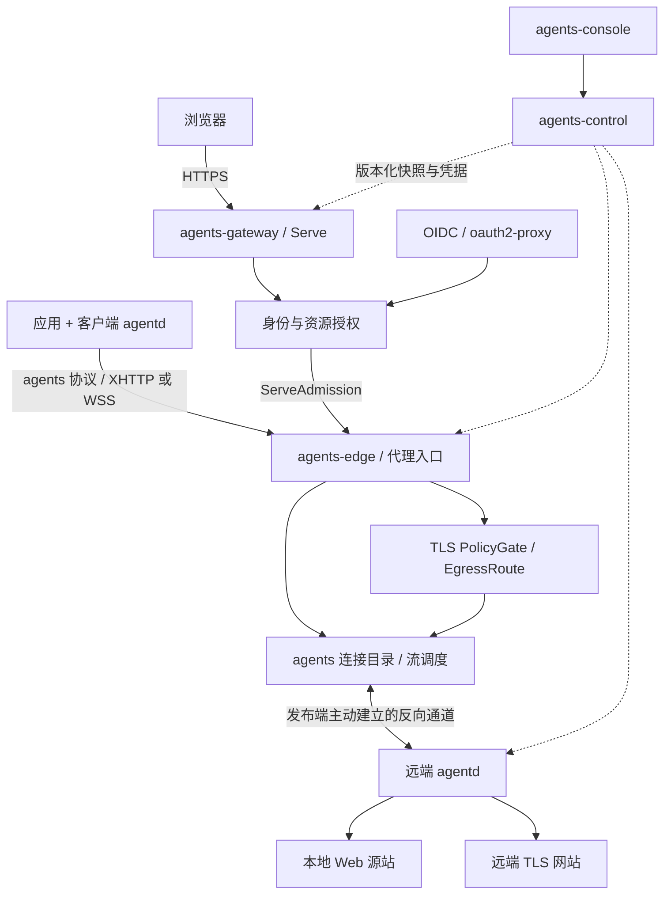
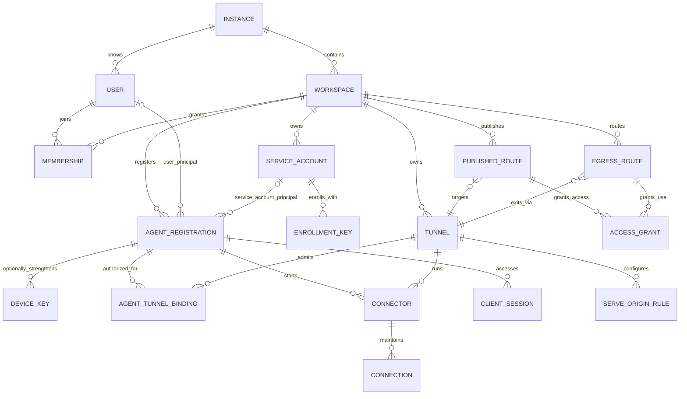
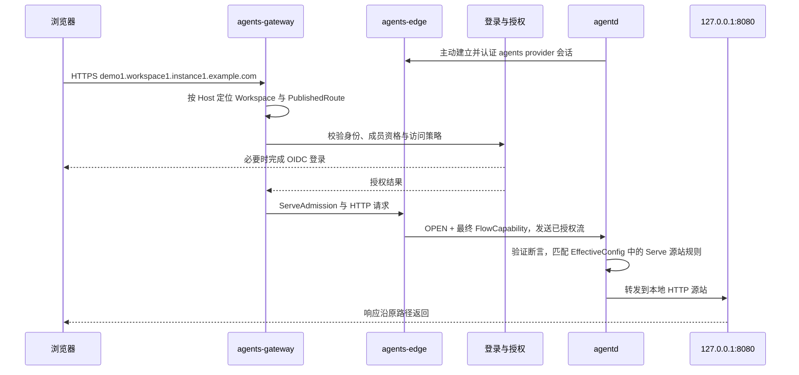
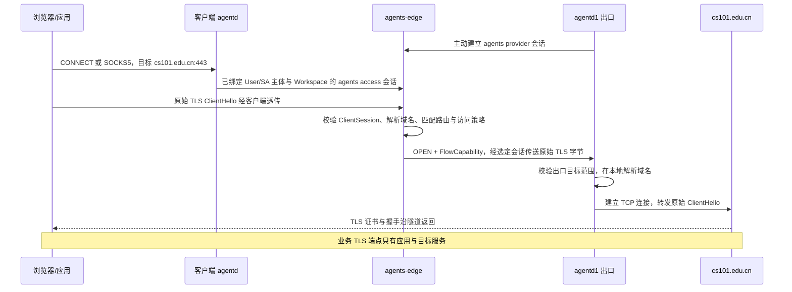

# agents / agentd 架构设计草案

日期：2026-10-18 修订。本文保留长期目标架构；独立 agents 仓库已交付 Control/Edge/Console、管理 REST、浏览器 OIDC 和 agentd/XHTTP v2 基础链路，Service Account 与 Hydra Device Flow 尚未实现。当前实际支持范围以两仓 README 为准，未来 Tunnel 分层、多节点及未验收时限不表示已交付承诺。身份模型与注册流程以 [User/SA 与 Hydra Device Flow 设计](https://github.com/Bit-Precise/agents/blob/main/docs/identity-and-device-flow.md) 为权威，优先于旧审查记录。

本方案保留 cloudflared 的 Tunnel、Connector、Connection、Route 与源站规则分层，借鉴 Headscale 的持久注册身份、身份分离、注册鉴权和策略分发。agents 自管认证、连接目录、业务流与授权；XHTTP/WSS 只提供面向 HTTP/CDN 的承载，具体 CDN 兼容性需要验收，不要求 VLESS、Xray Reverse/Mux 或 core.Instance。当前 agents 会话与流协议已实现 v2，WSS 仍延后。完整证据与源码版本见 [调研记录](agents-agentd-research.md)，逐项对齐与有意差异见 [对齐审查](agents-agentd-alignment.md)。

“对齐”指资源语义和架构原则，不表示 Cloudflare Tunnel、Tailscale/Headscale 的线协议、API 或配置文件兼容。Cloudflare 服务端未开源，本方案对其服务端行为的依据是官方公开文档和客户端可见的交互；agents 服务端是我们自己的实现。

**1. 已确认的需求与范围**

- 一个 agents 部署是一个 Instance，有固定域名，例如 `instance1.example.com`。
- Instance 下有多个 Workspace。User 是实例级身份，可通过 Membership 同时加入多个 Workspace。
- Service Account 固定且只能属于一个 Workspace，可以对应多个 Agent；不作为人类 User、不能登录 Console，只能由 maintainer 及以上管理/选用。
- 每个 Agent 固定一个 Workspace 和一个 User/SA 运行主体；`createdBy`、登录操作人 `actorUserId` 与运行身份分开。个人设备可使用本人 User，服务器 profile 必须使用 SA。
- agentd 同一二进制支持 Hydra OAuth Device Flow：人类 OIDC 登录后选择 Workspace 与本人/SA，再以限定用途的 AT 换每设备独立凭据；无人值守注册密钥绑定 SA。
- agentd 注册接入及 Serve/Egress 配置变更不需要人工审批。身份、RBAC 和策略自动校验成功即提交生效，非法请求拒绝，名称、版本或资源冲突返回 409；EffectiveConfig、revision、ACK 和 ready 只描述策略计算与技术应用状态。
- Workspace 角色为 owner、maintainer、developer、guest；另有实例级 instance admin，内部标识为 `instance_admin`。
- Workspace 域名为 `workspace1.instance1.example.com`。
- agentd 接入后获得稳定名称，例如 `agentd1.workspace1.instance1.example.com`。
- agentd 发布本地 Web 服务后获得独立子域名，例如 `demo1.workspace1.instance1.example.com`。
- Web 服务默认仅当前 Workspace 的有效成员可访问；有权主体可显式配置匿名访问 Grant。
- Web 服务可改为仅指定用户访问，或共享给同一 Instance 内多个 Workspace 的成员。资源归属不随分享变化，分享不授予 Workspace 成员或管理身份。
- 访问统一使用有期限的 AccessGrant：主体为 User、明确的 SA 或 Workspace 人类成员组；Web 服务的浏览器入口还允许匿名主体。SA 必须由支持机器主体的消费路径使用，不把设备凭据当浏览器凭据。每条授权独立起止、撤销并可与其他授权同时存在。
- 客户端 agentd 可提供 HTTP CONNECT、SOCKS5 或 TUN 接入，将 TLS 流量交给 agents-edge 按域名规则选择远端 agentd 出口。
- 出口模式保持目标业务 TLS 端到端加密。第一版支持 TCP 上的 TLS；SSH 是后续协议插件。
- 不提供私网地址分配、子网宣告、任意 IP 可达性、WireGuard、P2P 打洞或三层转发。
- agentd 通过本地 `config.yaml` 独立启用 ingress、serve、egress，单进程可任选一种或多种角色。
- XHTTP/WSS 是可替换承载；设备认证、会话准入、反向业务流、多路复用、管理 API 和租户授权由 agents 协议及其实现管理。

这里的 L7 是产品访问粒度：以身份、服务、目标域名和协议组织访问。TLS 透传的底层仍然是字节流转发与 ClientHello 元数据路由；它不能检查 TLS 内部 HTTP 路径、方法和响应，也不能证明所有后续密文承载的应用语义。

**2. 两种模式必须独立建模**

这里区分两种被提供的业务能力；访问角色 ingress 是它们之外的本机接入职责。serve 与 egress 可以共享一个 provider Connector 的双向承载会话，通过 agents 的 flow_id、purpose、FlowLease、FlowCapability 和业务 handler 隔离；ingress 使用绑定同一 User/SA 主体的独立 access 会话。一个进程可以同时承担三种角色，但凭据用途、访问授权与提供能力不能互相替代。承载层可建立一条或多条连接，不强制所有控制流和业务流共用唯一物理连接。

| 维度 | Web 发布：Serve | 域名出口：TLS Egress |
|---|---|---|
| 使用方式 | 浏览器访问服务子域名 | 应用通过客户端 agentd 的代理/TUN 访问真实域名 |
| 目标示例 | `demo1.workspace1.instance1.example.com` | `cs101.edu.cn:443` |
| 客户端是否必须有 agentd | 否 | 是 |
| 目标业务 TLS 终止位置 | gateway 接收浏览器 HTTPS；启用受信 CDN 时按该入口链路终止 | 原始应用与远端目标服务之间；中间全程不终止 |
| 消费者认证 | 浏览器 OIDC/User 或明确匿名策略，与 provider 主体分离 | 代理客户端凭据绑定 User/SA、Agent 及 Workspace |
| 授权对象 | PublishedRoute / AccessPolicy | EgressRoute / AccessPolicy / 自动策略校验后的出口能力 |
| agentd 末端行为 | 根据 Serve 源站规则转发到本地源站 | 在出口所在网络解析域名并连接目标 |

“目标业务 TLS 不终止”不等于系统没有 TLS 服务端：承载代理连接的 XHTTP/WSS 外层 TLS 仍在 agents-edge 或受信的入口代理终止，控制 API 同样使用 TLS。目标网站的 ClientHello、证书、握手和应用密文在外层隧道里传递。

**3. 组件划分与部署方式**

| 组件 | 职责 | 权限与状态边界 |
|---|---|---|
| agents-control | User/ServiceAccount/Workspace/Membership、Hydra login/consent、注册兑换、名称分配、路由、能力自动校验、凭据生命周期、审计 | 持久化业务事实；不承载业务正文 |
| agents-hydra | 标准 OAuth Device Authorization、轮询与 AT 签发/introspection | 独立 OAuth issuer；Admin API 仅供受信 Control，设备 public client 无共享秘密 |
| agents-gateway | 公网 Web/L7 FrontDoor、浏览器身份认证、PublishedRoute 与 AccessGrant 决策、Serve 请求流和 ServeAdmission 签发 | 不持有 agentd 反向连接；只能通过受信内部接口调用 Edge |
| agents-edge | agents 会话认证与准入、XHTTP/WSS 承载、Connector/Connection 目录、反向业务流与出口调度 | 数据面；持有有限期策略与会话租约、连接和活动流状态 |
| agents-console | Instance 与 Workspace 管理页面 | 调用 control API；没有独立授权判定权 |
| identity adapter | Control 对接上游 OIDC、维护人类浏览器会话并实现 Hydra login/consent app | 认证真实登录操作人；Workspace/SA 选择由本人完成，操作权限与设备主体由 agents 自动校验 |
| certificate worker | DNS、域名所有权和 ACME 证书申请/续期 | 独立保存 DNS API 凭据，gateway/Edge 只拿所需证书 |
| agentd | supervisor/orchestration、ingress 本机接入、serve 源站代理、egress 出口、agents 会话与承载适配 | 每个 Workspace profile 独立配置、凭据和运行状态 |

当前交付 `agents` 和 `agentd` 两个二进制，服务端已有 `agents control`、`agents edge`、`agents console` 三个进程和 `agents serve` 单进程开发模式。gateway 是独立逻辑安全边界，当前不要求单列进程。下一版增加独立 Hydra 依赖，不能用它替代 Control 的业务授权。公网 Serve 请求必须经过 gateway，不能通过 Edge 的内部入口绕过认证和资源授权。



第一版单实例、单 Edge、PostgreSQL。PostgreSQL 用于租户约束、事务和后续多控制节点；承载会话、连接目录和活动流留在本地内存。Redis 不是首版正确性的前提。

**3A. agents-edge 持有承载连接，按业务流授权后转发**

这里的“Edge 持有连接”有明确含义：提供方 agentd 主动建立到 agents-edge 的 agents provider 会话，Edge 保存 `Tunnel/Connector/Connection` 目录和健康状态。浏览器先接入 gateway，ingress 客户端以 access 会话接入 Edge；Edge 对每个业务流执行准入、选路和生命周期管理，然后在已经选定的 provider 会话上打开子流。

```text
提供方 agentd
    ──主动建立 agents provider 会话──>
agents-edge
    ├─保存 Connection owner / Connector / Tunnel
    ├─接收 gateway 已授权请求或 access 会话业务流
    ├─验证 gateway 凭证，或认证 access 主体并解析目标与有限 ClientHello
    ├─检查 AccessGrant、目的地约束、TunnelBinding 和 policy revision
    ├─选择真正应处理该流的 Connector
    ├─创建 FlowLease / signed FlowCapability
    └─仅把已授权的 capability 与业务字节转发给目标 agentd
                                      └─再次校验 capability
                                         └─连接本地源站或远端目标
```

Serve 中，gateway 先按 Host/path 和 Web AccessGrant 选择 `PublishedRoute` 与源站规则，Edge 验证其授权凭证后从该 Tunnel 的健康 Connector 集合选择提供方。Egress 中，Edge 先按已认证的 ClientSession、EgressRoute、canonical destination 和 `via` AgentRegistration 选择指定 Agent 的当前 Connector。Edge 不能根据“哪个 agentd 最近发来了 payload”反向决定授权对象。

反向承载连接本身可以空闲等待业务流；提供方 agentd 不得发送没有对应 `FlowLease` 的业务数据。未关联活动流、用途不符、Workspace/Tunnel/Connector/revision 不符或 capability 过期的 payload 必须丢弃并关闭该逻辑流。Edge 负责记录并关闭 Edge 侧流，agentd 负责验证 capability 并关闭本地源站/出口流；两端必须执行本地流取消与到期检查，不能只删除准入凭据。

对 TLS Egress，Edge 读取访问端提交的目标和有界 ClientHello 元数据，完成策略判断后原样重放已经缓存的业务字节；它不终止目标 TLS。对 Serve，gateway 已完成浏览器 HTTPS 与授权，Edge 将请求及绑定 PublishedRoute/ServeOriginRule 的最终 FlowCapability 交给 agentd。本文 ServeOriginRule（原 IngressRule）专指 Serve 源站规则，与本地 config.yaml 的 ingress 访问角色不同。XHTTP/WSS 不解析这些资源或决定业务目标。

**3B. agents-gateway 与 agents-edge 的请求方向**

Serve 和 TLS Egress 使用不同的入口方向，不能用一张“所有请求先到同一个 Gateway”的图混写：

```text
Serve：
浏览器
  → agents-gateway（TLS/HTTP、OIDC、AccessGrant、Host/path）
  → 受信内部接口 + ServeAdmission
  → agents-edge（Tunnel/Connector 目录和反向连接）
  → provider agentd
  → 本地源站

TLS Egress：
访问方 agentd
  → agents-edge（agents access 会话、ClientSession、有限 ClientHello）
  → PolicyGate / EgressRoute
  → 指定 exit agentd
  → 远端 TLS 目标
```

`agents-gateway` 是 Serve 的公网 L7 权威：它负责浏览器登录、匿名授权、跨 Workspace 分享判断、PublishedRoute/ServeOriginRule 匹配，并签发绑定资源、主体、Host/path、ServeOriginRule、revision 和过期时间的内部 `ServeAdmission`。它不直接保存或拨号 agentd 的反向连接，也不根据 DNS 直接连接某台 agentd。

`agents-edge` 是承载和连接目录权威：它验证 gateway 到来的 ServeAdmission，按 `PublishedRoute → Tunnel → healthy Connector` 选择实际提供方；对于 `via: agentd1` 的出口，按 `AgentRegistration → TunnelBinding → Connector` 过滤。没有受信 capability 的内部请求、传错 Workspace/route/revision 的 capability、以及没有对应活动 `FlowLease` 的 agentd payload 都必须拒绝。

gateway 到 Edge 的接口必须验证服务身份；同进程受限调用或经过认证的内部 HTTPS 均可，不强制 mTLS。ServeAdmission 绑定 canonical host/path、资源 Workspace、ServeOriginRule、policy revision、接收 Edge 和有效期。Edge 验证后选择 Connector，再签发绑定具体 Connector、会话 generation 和 flow_id 的 FlowCapability；最终权限和期限不得超过原授权。公网客户端不能调用内部接口，也不能通过 transport 入口绕过 gateway 获取 Serve 流量。

首版可以将 gateway 和 Edge 部署在同一个 `agents` 进程或同一个实例中，但代码和凭据边界必须保持分离；这样未来拆进程时不会改变数据流语义。Serve 的浏览器 TLS 可在 gateway 终止，Edge 只承载已授权的内部业务流；Egress 的目标 TLS 则继续在访问方和远端网站之间端到端透传。

**3C. agents-edge 的域名路由数据面能力**

agents-edge 是按域名和业务用途调度的连接数据面，不是三层网络路由器。它不分配网络地址、不宣告网段、不建立节点间任意可达性，也不把某个出口抽象成可承载所有目标的 Exit Node。Edge 的用户可见路由主键是规范化域名、端口、协议、Workspace、资源和 policy revision。

Edge 处理三类输入：

1. **Serve 内部流。** agents-gateway 已完成浏览器身份和 PublishedRoute 授权，向 Edge 发送 ServeAdmission 与 HTTP/流式业务。Edge 验证准入凭证，按 `PublishedRoute → Tunnel → Connector` 找到提供方 agentd，并在该会话上建立绑定最终 FlowCapability 的流。
2. **Egress 访问流。** ingress 角色通过 XHTTP/WSS 上的 agents access 会话接入 Edge。Edge 验证 ClientSession，读取 CONNECT/SOCKS 目标和有界 ClientHello 元数据，按 `EgressRoute → AgentRegistration → TunnelBinding → Connector` 选择指定提供方。
3. **Provider 会话。** 提供方 agentd 主动建立的反向承载连接。Edge 保存 Connector/Connection 目录、健康状态、用途和配置 generation；承载连接本身不等于已获准的业务流。

Edge 必须具备以下能力：

- **传输接入。** 接收 XHTTP/WSS 承载，在 agents 协议层验证 access/provider 会话，执行连接心跳、重连、排空、generation 和 owner 归属。
- **主体绑定。** 将访问连接绑定到 ClientSession、User/SA、Workspace 和 purpose；将 provider 连接绑定到 AgentRegistration、Tunnel、Connector 和当前 EffectiveConfig。客户端提供的 email、tag、路径或 target 不能作为租户身份。
- **域名提取与规范化。** Serve 使用 gateway 传入的 canonical Host/path；Egress 使用 CONNECT/SOCKS 域名和有界 ClientHello SNI。域名统一按 IDNA、大小写、尾点和 DNS label 边界规范化，明确 exact/suffix 语义；不接受任意数字地址作为用户路由主键。
- **策略决策。** 校验 AccessGrant、资源 Workspace、Workspace/Instance 约束、purpose、端口、协议、显式拒绝和 policy revision。没有匹配、策略过期、用途错误、域名与 SNI/CONNECT 不一致或 capability 无效时直接拒绝。
- **目标绑定。** Serve 只接受 gateway 签发的 opaque service target；Egress 只接受 Edge 规范化并签名的 canonical domain、端口和协议。Edge 不把客户端 target 原样交给承载层或 provider，也不让 provider agentd 自行从未签名字段猜测目标。
- **选路与粘性。** 对每个 FlowLease 固定一个实际 Connector；同一 HTTP/WebSocket/SSE/TLS 流的上下行必须落在同一 Edge owner 和同一逻辑流。指定 `via` 时只能选择对应 AgentRegistration 的当前 Connector，不能静默换成同 Tunnel 的其他副本。
- **流代理。** 以流式方式转发请求和响应，支持慢消费者、背压、取消、半关闭、SSE、WebSocket、上传下载和空闲超时；不能为等授权而无限缓存业务正文。目标 TLS 字节只做有限元数据检查后原样转发。
- **流级授权与撤销。** 每条业务流创建 FlowLease 和 FlowCapability，记录主体、资源、目标、Connector、revision、起止时间和取消句柄。撤销先禁止新流，再关闭 Edge/agentd 两侧的逻辑流；不能只撤销会话准入而保留业务流。
- **内部信任边界。** gateway→Edge 验证服务身份，Edge→agentd 使用已认证的 agents 会话；capability 绑定接收方、Workspace、资源、purpose、generation 和有效期。公网访问方不能调用内部入口，agentd 无对应 FlowLease 的主动业务 payload 必须拒绝。
- **失败关闭。** 不允许回落到 Edge 自身拨号、默认直连路径、其他 Workspace、未通过准入校验的 Connector 或“更宽”的域名规则。出口离线、策略陈旧、凭据过期和 capability 校验失败都返回可区分的拒绝/不可用状态。
- **配额与审计。** 按 Workspace、Connector、purpose、域名规则和 FlowLease 限制并发流、带宽、ClientHello 缓冲、请求体和空闲时长；记录 policy revision、Connector、结果、延迟、字节数和关闭原因，不记录业务正文或凭据。

Edge 不实现以下能力：任意端口代理、按网络地址选择路由、子网宣告、节点间三层转发、未授权的 DNS 解析后回落、根据客户端 SNI 自动跨 Workspace 选权、把反向连接直接暴露为通用代理。DNS 解析和实际拨号由选中的 provider agentd 在其本地网络完成，但它必须服从 Edge 签发的域名 capability 和本地允许范围。

第一版可以将上述能力放在一个 Edge 进程内；逻辑上仍应拆为 transport front door、connection directory、domain inspector、policy gate、flow broker、capability verifier、revocation manager、quota 和 telemetry 模块。将来多 Edge 时，Connection owner、XHTTP 上下行粘性和 FlowLease 归属不能被普通负载均衡隐式改变。

**4. 实体模型：保留 cfd 层次，增加明确的租户与策略实体**

| 实体 | 核心字段 | 生命周期 |
|---|---|---|
| Instance | id、base_domain、配置版本、状态 | 部署级 |
| User | id、OIDC issuer/subject、实例内唯一 username、已验证邮箱、资料、状态 | 实例级；身份唯一键为 `(issuer, subject)`，username 为可变查找名 |
| InstanceRole | user_id、role=instance_admin | 实例管理授权，界面称 instance admin |
| Workspace | id、instance_id、slug、状态、配额 | 持久化租户 |
| Membership | workspace_id、user_id、role、status | 多对多关系；同一用户在不同 Workspace 角色独立 |
| ServiceAccount | id、固定 workspace_id、name、status、created_by | 一个 SA 可对应多个设备；只有 maintainer+ 管理/选用，不能建立 Console 会话 |
| AgentRegistration | id、workspace_id、name、principal_type/id、created_by、credential_hash/version、effective_capabilities、状态 | 固定资源归属与唯一 User/SA 主体；包括纯访问客户端，不能静默改绑 |
| Tunnel | id、workspace_id、name、ownership、capabilities、状态 | cfd 风格的稳定逻辑隧道 |
| AgentTunnelBinding | workspace_id、agent_registration_id、tunnel_id、effective_capabilities | 经身份、RBAC 和策略自动校验的注册身份与 Tunnel 绑定关系 |
| EffectiveConfig | agent_registration_id、desired_generation、effective_capabilities、policy_revision、revision、valid_until | Control 自动校验得到的有效配置；应用结果通过 ACK 记录，不含人工审批状态 |
| Connector | id、workspace_id、agent_registration_id、tunnel_id、runtime_generation、版本、心跳、状态 | 一次提供方运行；重启产生新 ID |
| Connection | id、connector_id、edge_id、transport、generation、状态 | 一条逻辑隧道承载连接；不等同于 XHTTP 的单个 HTTP 请求或底层 socket |
| ServeOriginRule | id、tunnel_id、顺序、hostname/path、service、originRequest | Tunnel 的版本化 Serve 源站规则；原名 IngressRule |
| PublishedRoute | id、workspace_id、hostname、tunnel_id、serve_origin_rule_ids、access_policy_id、状态 | 外部服务名称与隧道入口的绑定；可关联同一 hostname 下多个路径规则 |
| EgressRoute | id、workspace_id、domain_match、ports、protocol、exit_tunnel_id、exit_agent_registration_id、access_policy_id、priority、状态 | 域名到出口的规则；指定 Agent 名称时同时约束注册身份 |
| AccessPolicy | id、workspace_id、条件、效果、revision | 资源访问约束与决策版本；主体授权由 AccessGrant 集合表达 |
| AccessGrant | id、resource_type/id、resource_workspace_id、permission、subject_type/id、starts_at、expires_at、revoked_at、created_by | 限定 PublishedRoute 的 service.access 或 EgressRoute 的 egress.use；匿名仅适用于 Web 服务 |
| ShareInvitation | resource_id、resource_workspace_id、已请求邮箱、邀请期限、拟授予起止时间、状态、redeemed_user_id | 邮箱验证后绑定用户并创建指定时间窗的授权，不授予 Workspace Membership |
| EnrollmentKey | workspace_id、service_account_id、角色/能力上限、使用次数、过期时间、token_hash、created_by | SA 无人值守注册引导凭据；旧 User key 只按迁移规则兼容 |
| EnrollmentAuthorization | Hydra issuer/client/challenge 关联、workspace_id、principal、actor_user_id、role ceiling、消费状态 | 一次 Device Flow 的受信选择与一次兑换记录，不能用同一 AT 批量注册 |
| TunnelCredential | tunnel_id、credential_id、类型、状态 | 属于 Tunnel 的长期运行授权凭据；不充当设备身份 |
| ClientSession | principal_type/id、workspace_id、agent_registration_id、凭据版本、期限 | User/SA 作为访问方的代理会话；不等于人类 Console 会话 |
| DeviceKey（可选） | agent_registration_id、key_id、public_key、状态、轮换版本 | 后续持钥认证强化的公开部分；不是首版接入前提 |
| DataPlaneLease | workspace_id、principal、connection_role、capabilities、connector/client_session_id、edge_id、generation、期限 | agents access/provider 会话的有限期准入租约，不等于业务流授权 |
| ServeAdmission | resource_workspace_id、principal、route/rule、canonical_host/path、revision、audience、期限 | gateway 对一个 Serve 请求的授权凭证；尚未选择 Connector |
| FlowLease | flow_id、workspace_id、principal、purpose、resource、connector/session_generation、revision、目标、期限、取消句柄 | Edge/agentd 两侧的活动业务流账本 |
| FlowCapability | flow_id、purpose、resource、Connector、generation、目标、revision、audience、期限、签名 | 绑定最终目的会话与业务目标的短期授权能力 |
| NameReservation | workspace_id、label、resource_kind/id、状态 | 同一 Workspace 内 AgentRegistration 名和服务名的统一唯一性 |

User 的邮件地址只作为资料，不作为跨身份提供方合并账号的依据。Headscale 也使用 `iss/sub` 标识 OIDC 用户，见 [OIDC 身份说明](https://headscale.net/stable/ref/oidc/)。



图中的 User/SA 主体关系是 XOR，Agent 必须且只能绑定其中一个；SA 与 Agent 必须同 Workspace，User 则必须具有有效 Membership。`createdBy` 不能充当这两个关系之一。按“每个 agentd 接入后都有稳定名字”的要求，所有安装/profile 先创建 AgentRegistration，`agentd1.workspace1.instance1.example.com` 绑定这个注册身份。纯访问客户端也有注册名称、control 会话和绑定主体的 ClientSession，不需要为了访问别人而创建服务 Tunnel。

提供 serve/egress 能力时，默认再创建一个专属 Tunnel 并建立 AgentTunnelBinding；也可以经授权加入已有 Tunnel。这个默认一对一是本产品的使用约定，不是 cfd 的强制要求。提供方每次启动产生新的 Connector，关联注册身份与 Tunnel；保持本地注册凭据与状态重启后名称不变。Connector 生命周期仍遵循 cfd：[client/config.go](https://github.com/cloudflare/cloudflared/blob/8e090e5bfa7a53e824fb2d7eb276f8ab08337b80/client/config.go#L23)。卸载并丢失注册凭据且无法通过受控恢复流程恢复时属于重新注册，不依赖主机名自动冒认原身份。

AgentRegistration 借鉴 Headscale 的持久 Node 注册职责，Tunnel 保留 cfd 的逻辑隧道职责。前者不分配 Overlay IP、不包含对等发现信息，也不使纯访问端自动可被其他用户访问。没有设备身份需求时不能把两个对象互换；现在增加它，是为同时满足所有 agentd 的命名和访问端生命周期需求。

Workspace 的资源与成员边界更接近 Cloudflare Account，而非 Zone 或 Headscale User。Cloudflare 用户也可属于多个 Account，见 [Accounts, zones, and profiles](https://developers.cloudflare.com/fundamentals/concepts/accounts-and-zones/)。具体 Workspace 角色、instance admin 和服务默认权限由本产品定义。

多个 agentd 经同一 Tunnel 的运行授权接入后成为副本，每个仍有独立 AgentRegistration 名称。副本应提供等价 Serve 源站规则与出口能力；不同网络出口、不同服务集合通常使用不同 Tunnel。指定 `agentd1` 出口时只选它的 Connector，不随机替换成同 Tunnel 的其他 Agent；这一具体 Agent 选择是本产品的出口策略扩展。名称唯一不意味着资源拥有固定网络 IP。

本轮修正：稳定名称从之前草案的 Tunnel 绑定移到 AgentRegistration，永久注册身份与运行期 Connector 明确分开。不另建通用 Site/Service 层。PublishedRoute 是 cfd 公共域名路由的扩展，ServeOriginRule 的 `service` 仍是源站配置。Workspace 与 Membership 是多租户需求新增的业务实体。DataPlaneLease 是 agents 会话准入记录，不是 cfd 或 Headscale 的原生实体。AgentRegistration 借鉴 Headscale 的持久注册与身份分离；首版可使用独立注册凭据与应用层短期 Token，设备密钥/证书认证是可选强化，不承诺兼容 Tailscale 注册线协议。

**5. 角色与权限建议**

控制面 RBAC 与业务流量 AccessPolicy 分开。能修改一个资源，不代表数据面可以跳过身份校验。默认成员策略包含 active guest；资源可以进一步限制为指定用户或角色，也可以显式共享给其他 Workspace 的用户。Web 服务的数据访问不以“必须先成为资源 Workspace 成员”为全局前提；具体由该服务的受众策略判断。

| 操作 | owner | maintainer | developer | guest |
|---|---|---|---|---|
| 查看 Workspace 基本信息 | 是 | 是 | 是 | 是 |
| 访问默认 member-only Web 服务 | 是 | 是 | 是 | 是 |
| 使用 TLS 出口 | 必须命中访问策略 | 必须命中访问策略 | 必须命中访问策略 | 必须命中访问策略 |
| 注册个人 agentd 作为访问客户端 | 是 | 是 | 是 | 是，仅 access 能力 |
| 创建/管理本 Workspace SA 与 SA 注册密钥 | 是 | 是 | 否 | 否 |
| Device Flow 中选择 SA 注册服务器设备 | 是 | 是 | 否 | 否 |
| 创建个人 Tunnel、发布自己的私有服务 | 是 | 是 | 是 | 否 |
| 管理全部 Tunnel / ingress / 服务路由 | 是 | 是 | 仅自己的资源 | 否 |
| 修改自己的源站地址 | 是 | 是 | 在允许的源站策略内 | 否 |
| 设置自己服务为本 Workspace 成员或其中的指定用户 | 是 | 是 | 是，仅自己的资源 | 否 |
| 共享给非本 Workspace 用户或其他 Workspace | 是 | 是 | 具有既有分享权限时直接操作，否则拒绝 | 否 |
| 将服务设为匿名公开 | 是 | 是 | 具有既有公开权限时直接操作，否则拒绝 | 否 |
| 管理 Workspace 出口规则与能力策略 | 是 | 是 | 否 | 否 |
| 声明或更新本人 Agent 的 Serve/Egress 能力 | 按主体和策略自动校验 | 按主体和策略自动校验 | 策略范围内直接生效，越界拒绝 | 否 |
| 邀请 developer/guest、移除其成员资格 | 是 | 是 | 否 | 否 |
| 赋予/撤销 maintainer | 是 | 否 | 否 | 否 |
| 转移 owner、删除 Workspace | 是 | 否 | 否 | 否 |
| 查看 Workspace 审计 | 全部 | 全部 | 自己的资源 | 无管理审计 |

至少保留一个有效 Workspace owner 和一个 instance admin；禁止自助提升角色。角色变更在事务中提交并触发凭据/策略失效。

instance admin（`instance_admin`）管理实例域名、身份提供方、用户启停、Workspace 创建/暂停/删除、配额和灾难恢复。默认不隐式成为所有 Workspace 的业务访问主体；需要通过明确的成员授权或受审计的紧急访问操作进入。实例操作者实际控制数据库和 Edge，因此这不是对实例管理员的密码学隔离承诺。

个人 AgentRegistration 的自管权限来自 `principal.type=user && principal.id=当前用户` 及有效 Membership，不来自 createdBy。成员离开时撤销该空间内的 User 设备及凭据，重新加入不自动复活。团队设备的主体是同 Workspace 的 SA，仅 maintainer+ 管理/选用；SA 可对应多个 Agent，创建者离职不影响已绑定 SA 的设备。同 SA 设备共享该 SA 的业务 Grant，但每个 Agent 仍有独立凭据、EffectiveConfig 和撤销边界。借鉴的是 Headscale 区分个人节点与服务节点的思路，不复用其特殊 tagged-devices 用户实现。[注册身份模型](https://headscale.net/stable/ref/registration/)

**6. 域名、DNS 与证书**

| 名称 | 用途 |
|---|---|
| `instance1.example.com` | 实例控制台和 API |
| `auth.instance1.example.com` | 中央 OIDC 登录入口 |
| `connect.instance1.example.com` | XHTTP/WSS 接入入口 |
| `workspace1.instance1.example.com` | Workspace 控制台 |
| `agentd1.workspace1.instance1.example.com` | AgentRegistration 的稳定名称；有经策略校验的有效出口能力时可用于选择出口 |
| `demo1.workspace1.instance1.example.com` | 已发布 Web 服务 |

用户示例中较短的 `agentd1.workspace1.example.com` 在本方案统一补上实例层级，使用 `agentd1.workspace1.instance1.example.com`。

Agent 名称用于资源选择与展示，不能访问这个名字就自动获得通用代理能力。其 DNS 记录即使指向 Edge，也默认只返回经过授权的状态页或 404。纯访问端的名字不开放任何反向服务。服务名必须存在已生效的 PublishedRoute 才能转发。

每个 Workspace 维护一个 DNS 名称空间；AgentRegistration 与服务共享 label 唯一性，防止 `agentd1` 同时被两个资源占用。Tunnel 的管理名称独立，不自动占用 DNS label。名称按 DNS label 规范化，禁止保留名称与超长名称。删除保留短期墓碑，避免立刻接管旧链接；重命名是显式变更，底层引用使用 UUID。

建议每个 Workspace 创建 `*.workspace1.instance1.example.com` 到 gateway 入口的 DNS 记录；`connect.instance1.example.com` 单独指向 Edge 的 XHTTP/WSS 接入入口。证书也按 Workspace 申请该通配符；`*.instance1.example.com` 只覆盖 `workspace1.instance1.example.com`，不能覆盖其下的服务域名。通配符证书匹配只覆盖一层名称，见 [RFC 9525](https://www.rfc-editor.org/rfc/rfc9525.html)。DNS 通配符规则不能替代证书校验规则。

certificate worker 使用 DNS-01 申请证书。Workspace 创建经历 `pending_dns → pending_certificate → ready`，证书未就绪前不发布 HTTPS 入口。Edge 不持有全局 DNS 修改权限。

**7. 注册与接入认证**

设备/profile、控制、访问和提供方身份分层。AgentRegistration 固定绑定 Workspace 和 User/SA 主体，其独立凭据表示这个 profile 的使用授权。Connector 是一次运行的元数据，不是凭据；ingress 的 access 会话与 provider 会话使用不同用途 Token，但同属当前 profile 的主体。`actorUserId` 记录真实登录操作人，仅是操作审计维度，不是审批岗位或设备业务身份，也不能用其 User Grant 替代选定 SA 的业务权限。

注册采用独立 agents-hydra 提供的标准 OAuth Device Flow；保留 SA EnrollmentKey 供无人值守部署。Hydra 管 OAuth 协议，Control 实现上游 OIDC 人类认证、Workspace/主体选择及 login/consent app。agentd 是 public client，不携带 Connect 或 Hydra 的共享 client secret。具体状态、AT 用途、重试及迁移以 [身份设计](https://github.com/Bit-Precise/agents/blob/main/docs/identity-and-device-flow.md) 为准；本节的目标流程没有人工审核队列。

拟定流程：

1. agentd 从可信 issuer discovery 获取 Device Authorization / Token endpoint，显示验证 URL 与 user_code，使用 `grant_type=urn:ietf:params:oauth:grant-type:device_code` 串行轮询并处理 slow_down。标准 `authorization_pending` 只表示等待用户完成本人的登录和身份选择，不表示等待管理员处理。
2. 浏览器完成上游 OIDC 人类登录，选择有权限的 Workspace，再选择本人或有效的同 Workspace SA。选择 SA 是一项要求 maintainer+ 的操作权限，Control 自动检查；服务器 profile 必须选 SA。本人 User 不能改选为另一个人，instance admin 的跨空间 SA 选用必须显式进入管理视图并记录操作来源。
3. Control 在调用 Hydra `AcceptLogin` 前固定 typed subject、Workspace 和 `actorUserId`，自动校验当前身份、Membership/SA 选用权限及角色上限。用户完成本人的选择授权后，Control 自动完成 `AcceptLogin` / `AcceptConsent`；consent 不能再替换 subject，不存在另一位审批人。每次 Device Flow 都重新确认本次选择，不能沿用其他设备的 remembered Workspace/SA；相关浏览器提交须绑定当前 OIDC 事务并校验同源与 CSRF。
4. Hydra 向 agentd 返回仅用于本 Instance 设备注册兑换的短期 AT。AT 不能登录 Console 或直接接入 XHTTP；它证明本次 Workspace/主体选择及注册权限，不替代对具体 Desired 的自动策略校验。
5. agentd 使用 AT 提交本地 Desired。Control introspect 并自动重检当前主体、Membership、SA 选用权限、角色上限、资源归属及能力策略；成功后在同一事务中一次消费授权、创建 AgentRegistration、EffectiveConfig revision 和每设备独立凭据。非法配置或越权请求直接拒绝，名称、版本或资源冲突返回 409，不创建待审核记录；客户端不能在请求体改写已选主体。SA EnrollmentKey 注册同样自动检查密钥、主体、角色上限和配置，不转入人工队列。
6. control/access/provider 凭据分别绑定 Agent、Workspace、User/SA 主体、用途和期限。注册及后续 Serve/Egress 变更都由相同的自动校验管线生成 EffectiveConfig；相关组件应用新 revision 并 ACK。ingress 的访问权仍须单独检查该 User/SA 主体的业务 Grant。
7. 提供方每次运行产生 Connector；Edge 对 XHTTP/HELLO 验证同一受信身份、当前角色和 EffectiveConfig revision，技术就绪后标为 ready。应用、证书或连接未就绪只表示暂不可用，不产生人工待办；客户端自报的 User、SA、Workspace、Host 和 header 都不作为身份来源。

DataPlaneLease 管理 access/provider 会话准入与失联上界；FlowLease/FlowCapability 管理每条业务流。续期不得扩大当前策略下的有效能力，generation 切换必须防止旧关闭事件移除新会话。provider 可共享承载 serve/egress；access 会话始终独立检查已绑定 User/SA 的 Grant，即使三角色位于同一进程。设备注册、提供能力自动校验与主体业务授权是三件独立的事。SA 不能建立 Console session；它的创建者或登录操作人离职不影响已独立绑定 SA 的设备，SA 自身撤销则使其全部设备和流失效。

采用受信 CDN 的 HTTPS 入口和 HTTPS 回源即可作为本版传输信任边界，不要求设备 mTLS，也不强制在 XHTTP 内再套 TLS。CDN 位于信任边界内；默认由 agents 在应用层验证设备与会话身份，不能把未经验证的转发身份 header 当作证明。可选的 CDN 客户端证书认证必须验证证书结果、清除伪造头并认证回源来源，具体约定见 [本地配置规范](agentd-config.md)。gateway→Edge 亦不强制 mTLS，但必须验证服务身份。目标网站的 Egress TLS 始终端到端透传。

同一用户在多个 Workspace 的设备/profile、ClientSession、监听端口、凭据和策略缓存分开；一个 SA 只能属于一个 Workspace，跨空间必须另建 SA/profile。不能根据目标 SNI 自动跨 Workspace 选择权限。一个 TUN 实例首版只激活一个 Workspace。

**8. Serve：浏览器访问本地 Web 服务**



公网服务域名进入 agents-gateway 的 HTTPS FrontDoor；直连时由 gateway 终止浏览器 TLS，经过受信 CDN 时由 CDN 终止客户端 TLS 并以 HTTPS 回源到 gateway。Host/HTTP2 authority 是 gateway 的服务路由依据；每个请求都检查 authority 与连接所允许的证书/入口范围，不因为某个 TLS 连接上先访问过合法服务就放行其他 Host。未知或未就绪的域名返回明确的 404/503。

oauth2-proxy 负责 OIDC 登录和身份确认；其 `/auth` 或等效接口返回成功不代表已经具备服务权限。Gateway 必须继续验证 PublishedRoute、AccessPolicy 与当前有效的 AccessGrant，非匿名授权还需检查实例用户状态及相应 Workspace 的有效成员关系；不能提前以“不是资源 Workspace 成员”为由拒绝一个显式获准的跨 Workspace 访客。Edge 还必须验证 gateway 签发的 ServeAdmission。不能信任浏览器自行提供的 `X-Auth-Request-*`、`X-Forwarded-User` 或 Workspace 请求头。[oauth2-proxy 集成说明](https://oauth2-proxy.github.io/oauth2-proxy/7.11.x/configuration/integration/)

统一的服务授权对象为 AccessGrant，不再使用互斥的 public/members/restricted 数据模型：

| subject_type | subject_id | 授权对象 |
|---|---|---|
| `anonymous` | 空 | 任何人，无需登录，也包含已经登录的访客 |
| `user` | 实例 User ID | 该用户 |
| `service_account` | SA ID | 明确支持机器消费身份的路径上的该 SA；不将设备 Token 当浏览器 Cookie/Bearer |
| `workspace` | Workspace ID | 该 Workspace 当前的有效人类成员；不自动包含 SA |

本节 Web 服务授权仅包含 `service.access` 权限；第 10 节的出口规则授权使用同一个 AccessGrant 模型，但绑定不同资源和 `egress.use` 权限，二者不能互换。每条授权有独立时间窗：`starts_at` 默认创建时刻，`expires_at` 必填，必须满足 `starts_at < expires_at`，可提前设置 `revoked_at`。时间按 UTC 存储，界面展示时包含时区。第一版不将空期限解释为永久授权；CLI 显式传期限，或采用 Workspace 配置的有限默认期限，并明确显示实际截止时间。

允许条件为：实例和资源仍有效、没有命中强制拒绝约束，并且至少存在一条未撤销、`starts_at <= now < expires_at` 且匹配当前访客的授权。多条授权按并集生效。仅有 Alice、Bob 两条 user 授权就只允许他们；存在 workspace1、workspace2 两条 workspace 授权时，任一组的有效成员可访问。资源创建者、owner 或 instance admin 不因管理身份自动绕过访问授权。

例如同一服务可以同时拥有匿名 1 小时、Alice 7 天、workspace2 成员 3 天的授权。匿名授权到期只移除匿名访问，其他授权继续有效。已登录状态不是授权有效期；延长 Cookie、重新登录或刷新隧道凭据都不能延长 AccessGrant。

“仅当前 Workspace”“指定用户”“公开”保留为界面/CLI 快捷操作：首次默认发布创建一条有期限的当前 Workspace 授权；显式选择首次受众时只创建列出的授权，不隐式附加默认授权。已有服务可以逐条增加、续期、撤销授权，也可明确地原子替换整组授权。添加匿名授权不会删除用户和 Workspace 授权。

添加或续期匿名授权、超出本 Workspace 的分享，分别受 `service.publish.public`、`service.share.external` 管理权限约束；owner/maintainer 默认具有这些权限。developer 可由 Workspace 管理员预先授予相应权限。Workspace 可限制默认/最大授权时长，延长期限必须重新检查权限。匿名授权只取消该服务的用户登录要求，不开放代理、源站配置和其他服务。停用 Workspace 或 Tunnel 时，即使匿名授权尚未过期也必须停止转发。

邮箱与 `@username` 是查找入口，控制端将其解析为稳定 User ID 后保存策略。username 必须是实例内唯一标识，不能使用可能重名的 OIDC display name；邮件身份要求已验证且解析结果唯一。多个账号使用同一邮箱时不自动合并，也不任意选一个授权。

未注册邮箱生成有期限的 ShareInvitation，标为待验证而不是已生效授权；收件人登录后必须用受信身份流程证明邮箱归属，并将邀请一次性绑定到一个实例 User ID，再按原先约定的起止时间创建 AccessGrant。邀请接受不会重新开始计算分享时长；截止时间已过则不再生效。它只授予指定服务访问，不自动加入资源 Workspace。未知/歧义用户名、解析错误不能回落为全员或匿名授权；明确撤销全部授权则使服务无人可访问。绑定完成后，用户名或邮箱变化不自动将访问权转给另一个账号。

共享受众第一版仅覆盖同一 agents Instance 的用户与 Workspace；尚未注册的被邀请人需先建立有效实例身份。分享给 Workspace 使用其稳定 ID，动态检查当前成员关系；新增成员获得访问，离开/停用后失去这一授权来源。若用户仍命中其他被允许的 Workspace 或直接用户授权，可以继续访问，控制台显示其授权来源。

跨 Workspace 分享只授予该 PublishedRoute 的 `service.access`。资源、Tunnel、agentd 和域名始终属于来源 Workspace；接收方不获得管理 API、其他服务、隧道凭据或出口权限。目标 Workspace 的成员列表不因此向发布者开放；分享选择器只暴露允许查找的身份信息。资源 Workspace 的策略拥有者决定是否分享，实例分享限制仍可进一步约束目标范围。

WebSocket Upgrade 在升级前授权；建立后进入活动连接账本。HTTP keep-alive 的每个请求重新检查授权。SSE、WebSocket 与进行中的下载在匹配授权到期/撤销时重新评估整个授权集合；没有其他有效授权则终止对应业务流，不能依赖已有连接无限续用。此前只按匿名身份建立的流，不能自动冒认某个指定用户，必要时关闭后由客户端完成登录再重连。授权到期不关闭供其他服务/有效授权共享的 provider 承载会话。

Gateway 向 Edge 签发 ServeAdmission；Edge 验证并选定 Connector 后，再向 agentd 签发绑定 Connector、会话 generation、flow_id 及资源 Workspace、Tunnel、PublishedRoute、策略版本、全局 User ID 或 anonymous、命中的授权来源、Host 与有效期的短期断言。跨 Workspace 访客的身份和资源 Workspace 分开表达，不能将其伪装成资源 Workspace 成员。agentd 验证 capability 签名、audience、作用域，以及实际 hostname/path 匹配到的规则必须等于断言授权的 ServeOriginRule 后才连接源站。授权断言由源站代理消费并剥离，不能原样交给业务应用；需要用户资料时只转发服务显式允许的字段。这个机制借鉴 [Cloudflare Access 在源站验证 JWT](https://developers.cloudflare.com/cloudflare-one/access-controls/applications/http-apps/authorization-cookie/validating-json/)，不复用 Cloudflare 的签名密钥或 token 格式约定。

JWT 和授权缓存的有效期不得超过本次决策所使用 AccessGrant 的截止时间；到期后重新决策，不能因 Cookie 仍有效继续放行。Edge 和 agentd 对已知截止时间本地执行，不等待控制面定时清理；到期清理任务只负责状态整理。节点时钟需要同步，异常偏差时不能延长授权。默认禁止未经授权检查的共享缓存命中，分享响应采用不允许下游长期缓存的策略；过期控制后续请求，无法撤回访客已经下载的内容。

源站选择保留 cfd 的 hostname/path/service/originRequest 思路：ServeOriginRule 按声明顺序 first-match，最后一条必须是兜底规则，默认返回 404。它不使用 EgressRoute 的 priority/域名具体度排序。gateway、Edge 与 agentd 复用相同的规则匹配和路径规范化代码，授权断言绑定同一个配置 revision 与最终匹配的规则。

支持本地 HTTP 与 HTTPS；HTTPS 源站证书由 agentd 验证。首版源站 URL 不带路径，保留请求路径，不自动 strip-prefix 或 rewrite-path，这与 cfd 的源站配置限制一致。Host 重写、超时与来源头在版本化配置内。需要路径改写时先由源站反向代理处理，后续功能另行定义。用户请求不能指定新的任意源站 URL。

**9. 多租户浏览器会话与 oauth2-proxy 边界**

统一登录不应靠一个发送到所有子域的宽 Domain Cookie 实现。所有服务子域共享上级站点边界，SameSite 本身不构成 Workspace 隔离。

推荐中央登录、每个服务独立会话：

1. oauth2-proxy/Identity Adapter 在 `auth.instance1.example.com` 持有 host-only 登录会话。
2. 未登录的服务请求发起绑定 Workspace、PublishedRoute、精确回跳地址和浏览器 state 的登录事务。
3. 中央登录成功后返回一次性、短时、绑定服务 origin 的兑换 code；不把长期 token 放在 URL 中。
4. gateway 的会话 broker 兑换 code，校验 state/重放/回跳地址，再在服务域设置 host-only `__Host-...` Cookie。
5. 服务会话只用于 agents 的鉴权，不转发到源站。用户访问其他服务时复用中央 SSO 完成短跳转，重新领取该 origin 的会话。

oauth2-proxy 提供身份适配，以上应用会话 broker 是 agents 的业务模块，不是假设 oauth2-proxy 已自带完整的跨服务授权。也可接入已有 IdP 的等效标准授权流程，但必须保留 host-only 会话与精确 redirect allowlist。

所有状态修改 API 校验 CSRF 与 Origin。清理外部提供的身份头；源站不能设置 agents 保留的会话 Cookie，也不能设置覆盖实例/Workspace/其他服务的 Domain Cookie。控制台和服务内容隔离 origin，避免租户业务内容获得管理页面权限。

**10. TLS Egress：经指定 agentd 出口访问远端服务**



身份从代理连接认证得到，不能从 SNI、HTTP Host 或来源 IP 推断。原始 TLS 会话内不能插入 OAuth 登录跳转、代理认证页面、用户请求头或 agents JWT。

每条 EgressRoute 使用限时 AccessGrant（`resource_type=egress_route`、`permission=egress.use`）。主体为当前 Workspace 的 User、有效人类成员组或明确的 SA；访问端必须有绑定同一 User/SA 的有效 ClientSession。SA 不继承人类创建者/登录操作人或全部 Workspace 成员的授权。第一版不支持匿名出口，也不把 Web 服务的跨 Workspace 分享自动扩展到出口。注册设备、启用出口、存在路由、主体拥有权限是四件独立的事。

每个出口另有目的地约束，作为 AgentRegistration/AgentTunnelBinding 的 EffectiveConfig：允许的协议、规范化域名、端口和显式拒绝项。有效允许范围为实例/Workspace 约束、控制端自动计算的有效域名范围与 agentd 本地域名限制的交集；本地可以进一步收紧，不能扩大控制端策略允许范围。任何适用的显式拒绝优先，AccessGrant 或新增路由不能覆盖它。域名解析和拨号由出口 agentd 在本地完成，解析结果是连接实现细节，不是用户可配置的路由主键。

例如公司 Agent 允许 `oa.com:443` 的 TLS、明确拒绝 `git.com`，其他域名默认拒绝。即使有人创建了 `git.com → office` 路由或持有有效的出口使用授权，Edge 仍应在转发前拒绝，公司 agentd 也在实际拨号前复核。域名 exact/suffix 语义必须明确，不能把 `oa.com` 错误匹配为 `evil-oa.com`；没有 canonical domain 的连接默认拒绝。禁止把拒绝结果当作连接故障改走其他出口。

出口级限制只约束该出口；如果要求整个 Workspace 都禁止访问 git.com，应在 Workspace 约束中声明，不能依赖单个公司 Agent 的规则代表所有出口。网站/公司网络自身的防火墙和认证仍然独立生效，平台授权不会消除这些限制。

同一用户可同时有 `cs101.edu.cn → 宿舍 Agent` 与 `oa.com → 公司 Agent` 两条授权，分别到期。某一条过期只终止不再获准的该路由业务流，不影响另一条路由、Agent 的其他服务或共享反向通道池。Edge 在真实访问时重新核对路由授权与期限，不能仅信任客户端配置里有这条路由。

示例规则（拟定管理配置）：

```yaml
workspace: workspace1
egress:
  - name: campus-cs101
    priority: 100
    protocol: tls
    match:
      source: sni
      exact: cs101.edu.cn
      ports: [443]
    via: agentd1.workspace1.instance1.example.com
    grants:
      - subject: {type: workspace, id: workspace1}
        permission: egress.use
        expiresIn: 24h
    onUnavailable: reject
```

配置中的 `expiresIn` 只在创建授权时解析为固定截止时间；重载配置、登录或连接重建不自动重新计时。正式 API 使用稳定资源 ID 与绝对 `expires_at`。

`via` 名称在当前 Workspace 解析为 AgentRegistration UUID，再取它经自动策略校验生效的出口 Tunnel Binding；执行时同时约束 Tunnel 和 AgentRegistration，只选择该注册身份当前可用的 Connector。它不通过公网 DNS 将 agentd 名字当成目标网站，也不因为同 Tunnel 有其他副本就改变指定的出口 Agent。有权管理 Workspace 路由的 owner/maintainer 可以直接配置规则，Control 自动校验其操作权限、主体和目标范围；出口 agentd 同时在本地显式启用 egress，实际能力取声明与策略交集。这里保留控制端策略和本地意图两道限制，不引入人工确认步骤。[路由策略参考](https://headscale.net/stable/ref/routes/)

Cloudflare One 也公开提供按 hostname 将访问流量交给指定 cloudflared 出口的功能，见 [Egress through Cloudflare Tunnel](https://developers.cloudflare.com/cloudflare-one/traffic-controls/egress-policies/egress-cloudflared/)。我们借鉴“访问方接入 → 网关授权/选路 → Tunnel 出口”的分工；不复制其 WARP、initial resolved IP 或闭源 Gateway 实现，也不把这份文档当作我们端到端 TLS 行为已验证的证据。

路由匹配与访问授权分两步：按优先级确定应适用的规则，再检查主体是否有权使用它；授权失败直接拒绝，不能继续尝试更宽的允许规则。相同优先级中 exact 优先于 suffix，suffix 取最具体匹配，仍冲突则拒绝配置。后缀匹配遵守 DNS label 边界。

没有规则、出口离线、凭据过期或策略不可用，默认拒绝。不得自动改成 agents 服务器直连，也不能切到另一个未获授权的出口。显式备用出口必须具备相同作用域和访问策略。

**11. SNI、目标域名、ECH 与 DNS 的精确定义**

ClientHello 的明文 SNI 可用于选路，不是用户身份，也不是独立的授权凭证。出口规则约束 canonical domain、端口和协议；最终连接由出口 agentd 按 capability 中的域名发起。解析结果不改变域名路由语义。

| 输入情况 | 第一版处理 |
|---|---|
| CONNECT/SOCKS 提供域名且有同名 SNI | 正常匹配、授权和出口拨号 |
| 提供域名但 SNI 不同 | 默认拒绝，返回可定位的策略错误 |
| 只有地址目标、没有 canonical domain | 默认拒绝；TUN 只有在本地 DNS/FakeDNS 已绑定到获准域名时才可建立域名流 |
| 无 SNI、超时或 ClientHello 无法解析 | SNI 模式默认拒绝；不回落为通用 TCP 代理 |
| ECH 隐藏真实 SNI | 无法按真实 SNI 决策；严格 SNI 模式不将 outer SNI 当作已验证的内层域名 |
| 管理员显式配置 authority 模式 | 可按已认证代理请求的目标域名选路，但 UI 必须注明未验证内层 SNI，不能宣称这是 SNI 路由 |
| UDP/QUIC/HTTP3 业务 | 第一版不转发；不为它提供隐式 UDP 出口 |

ECH 的加密 ClientHello 设计使中间节点无法读取真实名称，见 [RFC 9849](https://www.rfc-editor.org/rfc/rfc9849.html)。中间节点也不能把 ECH 扩展的存在简单等同于真实 ECH，因为可能是 GREASE；严格拒绝这一类握手会有兼容性代价，必须实测并明确提示，不能把 ClientHello 检查描述为能识别 ECH 内部名称。SNI、authority 都来自客户端声明；没有可验证的 canonical domain 时不能进入域名路由。系统仍不能在不解密业务 TLS 的前提下验证其中的 HTTP Host/URL，也不能为共享目标域名提供内容级隔离。

TLS PolicyGate 必须将经授权的 canonical destination 写入 OPEN/FlowCapability，出口 agentd 只按这个目标拨号并再次校验。承载层的目标提示、SNI sniffing 或 HTTP 路径均不能代替业务授权。

出口在其所在网络进行 DNS 解析，确保校园/企业网络的域名解析语义。解析与拨号使用同一份结果，限制 CNAME 深度和总时间；agentd 可以执行本地安全目标检查，但该检查不向用户暴露为路由对象，也不能把解析结果加入 AccessGrant 或 EgressRoute 的授权主键。

TLS 元数据读取有明确的字节上限、超时、内存和并发预算，保存已读字节并完整重放到选定通道。TCP 分片、TLS record 分片、大 ClientHello、错误长度与慢速发送必须进入测试矩阵。agents 的 domain inspector 自己定义解析预算与拒绝行为，不依赖某个承载实现的默认 sniffing。

**12. 本地 config.yaml 与三种运行角色**

每个 Workspace profile 通过本地 `config.yaml` 声明 ingress、serve、egress，可单独启用，也可在同一 agentd 进程组合启用。配置格式与完整示例见 [本地配置设计](agentd-config.md) 和 [config.yaml](../examples/agentd/config.yaml)。这些文件描述拟定接口，不代表已有可运行 CLI。

| 角色 | 本地职责 | 服务端对应关系 |
|---|---|---|
| ingress | 监听本机 HTTP CONNECT / SOCKS5 / TUN，将匹配域名流量送到 Edge | User/SA ClientSession 与独立 access 会话；本地匹配不产生 AccessGrant 或 EgressRoute |
| serve | 声明服务名、本地 HTTP/HTTPS 源站及来源限制，由 Control 自动校验 | PublishedRoute 与 ServeOriginRule；服务名不等于 AgentRegistration 名称 |
| egress | 声明本机愿意提供的目标域名、端口、协议及本地限制 | AgentTunnelBinding 的出口能力；Edge 的 EgressRoute 决定 domain→Agent，仍需自动策略校验和独立的 User/SA 主体访问授权 |

本地 ingress 规则只决定哪些连接进入 agents；Edge 始终重新决定身份、EgressRoute、AccessGrant 和实际出口。客户端不能用本地 `via` 提示、匹配列表或设备身份扩大权限。egress 声明只表示本机同意，不因此绕过 Control 对主体、角色和目标范围的自动策略校验。serve 与 egress 可共享 provider Connector/承载会话；启用 ingress 不复用 provider 身份访问他人资源，也不要求它们共用唯一物理连接。

HTTP 模式首版只提供 CONNECT，SOCKS5 只接受 TCP CONNECT；不隐式开放明文 HTTP 转发、UDP ASSOCIATE 或通用 TCP 出口。两者默认监听 loopback；共享给其他本机账号或局域网时需显式访问认证，不能把所有本机进程当作当前登录用户。CONNECT/SOCKS 成功应明确表示代理承载已建立；应用通常随后才发送 ClientHello，不能等待 ClientHello 授权后才返回该成功响应。后续策略拒绝必须终止对应流，不拨号目标。

本地匹配、Edge 规则和出口限制采用同一域名规范化：IDNA、大小写和尾点统一，exact/suffix 按 DNS label 边界匹配；端口、协议分别验证，不把 URL、IP 文本或任意通配符当域名规则。本地未匹配、没有 canonical domain、Edge 拒绝、出口离线及不支持的流量默认拒绝。未被本地捕获的系统直连流量不属于 agents 授权范围；策略拒绝或出口故障不能触发自动直连。

TUN 首版只验证 Linux，通过本地 DNS/FakeDNS 保留域名关联；共享 IP、过期映射或无法确定域名时不能猜测目标。DNS/FakeDNS 是本机捕获实现，不提供通用 UDP 转发。control、transport 以及本进程 serve/egress 的源站和目标拨号必须绕过本机 TUN 捕获，使用可验证的 socket 标记/绑定等机制防止三角色组合产生递归，不能只依赖易变化的域名/IP 排除列表。上述 control、transport、源站及出口拨号还必须使用真实 resolver 绕过本机 FakeDNS；仅绕过 TUN 仍可能解析到合成地址并导致错误拨号。

本地角色停用、服务删除和限制收紧立即停止受影响的新流并关闭不再允许的活动流，同时向 control 撤回声明；新增发布、扩大出口范围、改变资源授权等由 Control 自动校验，合法变更随新 revision 提交并分发，相关组件应用及 ACK 后承接业务；非法变更直接拒绝，版本或资源冲突返回 409。热重载必须先完成严格 YAML/schema 校验，拒绝未知字段与重复键，并原子切换有效配置；语法错误保留上一份已生效配置并报告错误，不能半应用。

**13. agents 协议与承载适配边界**

agents 自己管理设备/用户认证、控制与数据会话、Connector/Connection 目录、OPEN 与流取消。XHTTP/WSS 仅传输字节；产品不依赖 VLESS 用户表、原生 Reverse picker、Mux target、Xray dispatcher 或每 Workspace 一个 core.Instance。历史 [Xray Reverse PoC](../poc/xray-reverse/README.md) 证明了旧承载方案的基础可达性及撤销/目标授权限制，不是新协议的验收结果。

拟定 agents 会话先交换协议版本、应用层会话凭据、DataPlaneLease、connection role、Workspace 和 generation；provider ready 后 Edge 可在选定会话上发起业务 OPEN。每个 OPEN 至少携带 flow_id、purpose、资源、revision、最终目标、期限与 FlowCapability。后续使用有界 DATA、FIN、RST 和流量窗口表达数据、半关闭、取消与背压；FIN 不等于关闭共享承载。流 ID 不得跨 generation 复用，重复 OPEN、过期 capability、未知流数据和越界窗口必须拒绝。可复用成熟多路复用组件，但其状态必须受 agents 流账本控制。

Serve 使用 gateway 的 ServeAdmission，Edge 选择 Connector 后签发最终 FlowCapability；egress 由 Edge PolicyGate 校验用户、SNI/authority 与域名规则后签发目标能力。Edge 在同一准入临界区内检查当前 revision/generation 并登记 FlowLease，再允许发出 OPEN，避免撤销扫描后又登记旧授权流。agentd 在 OPEN 时复核当前 EffectiveConfig 和本地限制，核验通过才连接获准源站或目标；准备就绪后返回 OPEN_OK 并允许转发业务字节。流能力通过协议元数据承载，不能插入目标 TLS 字节，也不能原样转交给 Serve 业务应用。

`transport` 包对上暴露受控 Dial/Accept、读写、关闭与可观察状态；业务包不引用 Xray 内部类型。可优先验证直接调用固定版本 XHTTP 的 Dial/ListenXH，或使用受限字节管道适配；不把它描述为已有独立稳定 SDK。传输层的 deadline、取消、半关闭及监听器关闭不能只看接口签名，必须验证能解除阻塞并回收活动连接。全局连接池与共享 Go 进程不是 OS 级租户隔离；每个 Workspace/会话/流分别限制资源，需要更强隔离时可分进程部署。

公网 TCP/443 的 FrontDoor 按用途分开：控制台和服务域名进入 gateway，`connect.instance1.example.com` 进入 Edge 的 XHTTP/WSS 承载。受信 CDN 通过 HTTPS 回源；origin 入口验证预期来源/服务身份，设备认证仍由 agents 握手完成。接入路径只负责定位，不能代替 Workspace/role 认证。应用认证之前也要限制握手时长、连接数、HTTP session 和缓冲，不能只计算已认证租户的配额。

CDN 前后是不同 HTTP 连接，客户端 h2 不保证回源 h2；h2 支持也不保证流式上传。XHTTP 的 stream-one/stream-up/packet-up 与 WSS 必须分别验证上传和响应缓冲、长连接期限、取消、缓存与会话归属。HTTP 头或 Flush 不能保证所有 CDN 禁用缓冲。普通 HTTP/2 不自动提供 Edge→agentd 反向业务流；该能力由 agents OPEN/流协议实现。首版不承诺任何 CDN 或所有 XHTTP 模式均可工作。

业务流采用有界缓冲、每流与每会话窗口、公平调度和控制消息预算，防止慢消费者阻塞心跳与撤销。未匹配、策略过期、错误用途、解析错误或出口离线都进入明确拒绝；承载适配器不具有通用目标拨号或默认直连权限。任何一侧会话丢失都关闭关联旧流，新连接重新握手，不能自动重放已发送的业务数据。

**14. 租户隔离必须落到数据结构**

- 所有 Workspace 资源都有不可为空的 `workspace_id`；子资源使用组合外键或等效事务约束，防止把 A 的规则引用到 B 的 Tunnel。
- 唯一明确的分享例外是 Web AccessGrant 的主体引用：可指向同一 Instance 的全局 User ID 或其他 Workspace 的成员集合。它不改变资源外键归属，也不允许跨 Workspace 选择 Tunnel/出口。
- 人类管理 API 从认证上下文确认 User，再检查 Membership/实例管理权限；设备控制与数据面从凭据确认 User/SA、Agent 和 Workspace。SA 必须同空间，不能伪造为 User；不能信任 URL/Host 单独宣称的租户。
- 存储查询、缓存 key、连接目录、策略快照、凭据映射、流量统计均包含 Workspace ID。
- 每个租户配置最大 Connector、连接、活跃流、ClientHello 缓冲、带宽和速率配额。
- Host 规范化后精确查 PublishedRoute；服务名中包含合法 Workspace slug 不代表有权访问。
- 本地 HTTP keep-alive 池按 Workspace、Tunnel、服务和配置 generation 隔离。
- 未授权请求返回前不触发目标 DNS、源站拨号或出口流量。
- SQL 可追加 PostgreSQL RLS 作为纵深隔离；应用层 scope 和组合约束仍是必要条件。

**15. 本地期望配置、自动策略校验与撤销**

本地 `config.yaml` 是 agentd 运行角色、监听方式、服务源站与本机能力/限制的 Desired；control 是租户授权、资源归属、PublishedRoute、EgressRoute、能力策略及 AccessGrant 的权威。Control 根据已认证的 User/SA 主体、RBAC、角色上限和实例/Workspace 策略自动计算 EffectiveConfig。运行时有效能力还受当前本地限制约束；本地文件不能扩大控制端策略允许范围，control 也不能强迫已在本地关闭的出口或服务继续运行。

注册和每次 Desired 变更使用同一管线：合法请求直接提交 EffectiveConfig 与新 revision；非法或越权请求拒绝，名称冲突、歧义路由或并发版本冲突返回 409，不存入待人工处理队列。Control 不因请求声称是“个人设备”或来自原创建者而放宽校验。声明超出角色或能力边界时必须报告拒绝，不能静默裁剪后谎称原请求已全部应用。

停用角色、删除服务、收紧本地目标范围或主动断开在本机立即生效，关闭不再允许的流并上报撤回；控制面失联也不能阻止本地停用。新增发布、更改源站、扩大允许目标或改变分享范围，自动校验通过即提交并分发，无需管理员点击确认。新增允许在技术应用完成前不能先开放；校验失败保留此前合法版本，同时保留已经执行的安全收紧。修改资源访问策略本身仍需相应管理权限；无权限就拒绝，而不是申请例外。

```text
本地严格解析 config.yaml / 生成 desired generation
    → 先执行本地停用或限制收紧，并上报声明
    → Control 自动校验身份、RBAC、角色上限、资源归属和能力策略
    → 非法请求拒绝；名称、资源或版本冲突返回 409
    → 合法请求事务提交 EffectiveConfig + revision + 配置/会话租约
    → gateway / Edge / 相关 agentd 原子应用并 ACK
    → 证书、provider 会话与实际业务健康检查就绪
    → 激活匹配的 PublishedRoute / EgressRoute generation
```

EffectiveConfig、revision、generation、ACK 与 ready 是策略结果和配置应用的一致性机制，不表示审核状态。ACK 必须标识资源、配置 generation、policy revision 和应用结果；仅收到快照不是应用成功。Serve 激活需 gateway、Edge、provider 都持有同一 EffectiveConfig revision；Egress 激活需 Edge 与指定 provider 就绪。各侧原子切换不可变配置，乱序版本不能覆盖较新版本；配置写入以 expectedRevision 等版本条件检查并发，冲突返回 409。安全收紧不得因健康检查失败回滚到已撤销的 allow；新配置不能安全应用时保留更严格状态并报告不可用，不能伪装成等待某人确认。

配置快照包含 Workspace ID、revision、generation、valid_until 和签名，通过 HTTPS 拉取、长轮询或 SSE 监听。断线后重取完整快照；数据库事务与 outbox 联动，防止提交后漏发更新。注册凭据轮换、签名信任根、租约签发及故障恢复协议仍为待实现内容；若启用可选 DeviceKey，也需定义其轮换与恢复。

拟定时限预算：控制心跳 15 秒；DataPlaneLease 5 分钟并提前续期；授权策略快照最长陈旧 60 秒；授权缓存不超过 15 秒。每条 FlowLease 的失效上界取授权期限、当前策略快照、会话租约与流自身期限中最早者；已知 AccessGrant 截止时间不能被缓存或离线窗口延长。gateway、Edge、agentd 均需本地到期执行，不能等待后台清理或对端主动断开。长流续期必须重新评估当前有效授权与策略，不能因为承载心跳或会话续租而自动延长业务授权。这些数值是待验证配置，不是承载协议默认保证。

User 禁用、Membership 删除、SA 撤销、Workspace 暂停、AgentRegistration/DeviceKey 停用、Tunnel/Binding 撤销、服务分享撤销或出口能力收回都触发同一失效流程：先禁止失去授权的新会话/流，再重算并关闭受影响的活动流，更新目录与策略，记录审计。User 事件影响 User 主体设备，SA 事件影响 SA 设备；SA 的创建者/登录操作人离职不自动撤销已经绑定 SA 的设备。单 Agent 撤销不撤同 SA 其他设备。多个有效授权按并集计算，不能因 Cookie/注册 AT 续期延长 Grant。跨 Workspace 人类成员变化只传播到相应成员组策略，不将其扩大成 SA 的身份关系。

控制面正常时主动撤销目标为秒级；失联时只能保证上述租约计算的最大暴露时间，不能声称即时得知未知撤销。收紧策略和替换受众必须原子生效，不能出现短暂公开或恢复全员访问窗口。Edge 禁止新流与 FlowLease 登记使用同一版本栅栏，防止并发撤销漏掉刚建立的流。

关闭语义由 agents 掌握：RST/cancel 关闭特定流与本地源站/出口 socket，普通撤销不关闭共享承载中其他合法流。会话撤销、代际替换或故障恢复则先移除准入资格，再关闭对应旧会话及全部关联流；旧 generation 的事件不能删除新目录。进程重建是故障兜底而不是日常授权机制。历史 PoC 中 RemoveUser 无法撤销旧流的结论仍成立，但新设计不再使用该调用实现产品撤销。

**16. 多 Edge 与连接归属**

```text
workspace_id + tunnel_id
    → 健康 Connector 集合
    → 指定 Agent 出口时按 agent_registration_id 过滤
    → 每个 Connector 的 Edge owner / generation
    → 已认证且 ready 的 provider 会话 / 具体 Connection
```

首版一个 Edge，不提前实现分布式会话迁移。扩展时 control 只保存归属与租约，连接仍属于实际接收它的 Edge。接入负载均衡不能把同一个 XHTTP 上下行会话随机发到不同节点；使用节点定向入口或按会话标识的粘性分发。

Serve 请求落到非归属节点时，通过带节点认证的内部 HTTPS 转发到 owner Edge，重新验证内部路由凭证。TLS Egress 可用经过节点身份认证的 HTTPS CONNECT 做节点间转发，CONNECT body 保持目标业务 TLS 不变。内部凭证绑定 Workspace、主体、目标 Tunnel、canonical destination、策略 revision、接收节点和有效期，禁止外部客户端直接调用内部入口。

一个 Tunnel 的副本要求服务/出口等价；默认优先可用性，不暴露伪装成 cfd 默认能力的权重轮询。需要不同出口选择，使用多个 Tunnel 和显式 EgressRoute。跨节点失败不自动重放已经发送数据的连接；新请求重新选路，长连接由客户端应用重建。

**17. 存储、API 与代码组织**

管理 API 已按 `/v1/admin/*` 与 Workspace 子资源分层；已实现精确契约以 agents 仓库的 OpenAPI 为准。下表中的 Service Account、Hydra 相关注册兑换为本轮新增目标，尚未实现：

```text
/v1/admin/users
/v1/admin/workspaces
/v1/admin/agents
/v1/admin/service-accounts                                      # 待实现
/v1/workspaces/{workspaceId}/memberships
/v1/workspaces/{workspaceId}/agents
/v1/workspaces/{workspaceId}/ingresses
/v1/workspaces/{workspaceId}/servers
/v1/workspaces/{workspaceId}/egresses
/v1/workspaces/{workspaceId}/routes
/v1/workspaces/{workspaceId}/grants
/v1/workspaces/{workspaceId}/enrollment-keys
/v1/workspaces/{workspaceId}/service-accounts                    # 待实现
/v1/workspaces/{workspaceId}/service-accounts/{id}/enrollment-keys # 待实现
/v1/agent-enrollments                                           # 待实现，Device Flow AT 兑换
/v1/admin/audit-events
```

`instance_admin` API 与 Workspace API 分开。所有集合使用 `items + pagination`，支持服务端筛选排序；主体类型和 ID 是查询字段，createdBy 只作审计维度。配置更新使用 expectedRevision 等版本条件防止覆盖并发变更；Control 自动校验后提交 EffectiveConfig，版本或资源冲突返回 409，非法请求直接拒绝；Device Flow AT 兑换以唯一授权记录和事务防止重试重复创建设备。命令行和控制台调用同一服务层，API 客户端仍由 OpenAPI 生成。Hydra 标准 Device Authorization / Token URL 从 discovery 获取，不改写成自制的 agents OAuth grant。

```text
cmd/agentd/
cmd/agents/
internal/
  identity/          # User/SA、上游OIDC、Hydra login/consent、浏览器及typed设备身份
  tenancy/           # Workspace、Membership、实例角色
  registrations/     # AgentRegistration、名称和 AgentTunnelBinding
  tunnels/           # Tunnel、Connector、Connection 生命周期
  credentials/       # EnrollmentKey、TunnelCredential、Lease
  serveconfig/       # ServeOriginRule（Serve 源站规则）及 originRequest
  localconfig/       # config.yaml、三角色期望状态与热重载
  publication/       # PublishedRoute 与名称绑定
  egress/            # 域名出口、能力宣告、自动策略校验
  policy/            # 决策模型、编译、版本、可解释拒绝
  gateway/           # Serve HTTPS、浏览器会话、ServeAdmission
  edge/              # 会话准入、连接目录、业务流调度与节点转发
  policygate/        # agents 侧 TLS 识别与授权执行
  origin/            # agentd 源站代理
  agentprotocol/     # 会话握手、OPEN/DATA/FIN/RST、流控与取消
  transport/         # XHTTP/WSS 可替换适配；Xray 类型只在适配边界内
  supervisor/        # 三角色、承载连接、重连、排空与恢复
  orchestration/     # 版本化配置应用、ACK、回滚
  naming/            # DNS 名称唯一性与规范化
  certificates/      # DNS/ACME 任务
  storage/           # PostgreSQL、事务、outbox
  audit/             # 操作与授权审计
  telemetry/         # 日志、指标、追踪
web/console/
integration/
```

每次访问的审计记录包含 Workspace、认证主体、服务/规则、Tunnel/Connector、结果、策略版本、字节数和耗时。业务密文不记录，HTTP 正文默认不记录，凭据和 Cookie 不记录。承载适配器或协议错误可能包含凭据和内部标识，必须在日志边界统一脱敏，不能直接透传为普通日志。

**18. 首版范围与验收矩阵**

| 阶段 | 交付 | 退出条件 |
|---|---|---|
| P0：关键技术验证 | agents 会话认证、流协议、修改版 XHTTP packet-up、PolicyGate、流量撤销 | CDN 链路可用；三角色可组合；精确 Connector 选路；无跨租户流；撤销可证明；目标证书原样可见；当前本机测试仅覆盖其中子集 |
| P1：多租户基础 | User/Membership/RBAC、AgentRegistration、Tunnel/Connector、名称、DNS/证书、PostgreSQL | 双 Workspace 隔离、同一用户不同角色、owner 管理、重启身份语义符合模型 |
| P2：Serve | 私有服务、显式 public、oauth2-proxy 集成、host-only 会话、Serve 源站规则 | 成员默认访问、非成员拒绝、源站无法获得平台 Cookie、SSE/WS/上传下载 |
| P3：TLS Egress | 域名规则、出口本地声明与控制策略的交集、HTTP CONNECT/SOCKS5、出口 DNS、Linux TUN | 同一个域名在两个 Workspace 可走不同出口；ClientHello 不改动；无 canonical domain 或 SNI/域名不一致时拒绝 |
| P4：v1 加固 | 配额、崩溃恢复、失联租约、备份、审计、升级 | 故障与资源压力测试通过；发布范围仍为单 Edge |
| 后续 | 多 Edge、H3 外层传输、更多 TUN 平台、SSH | 独立设计与验收，不改变既有租户语义 |

P0/P4 必须覆盖：

- 个人 Device Flow 和 SA-key 注册，以及 Serve/Egress 配置新增与变更，在自动身份/RBAC/策略校验通过后直接生效；非法请求拒绝、名称或并发冲突返回 409，全链路不产生管理员待办。Hydra `authorization_pending` 仅等待用户自己的登录/身份选择，技术应用中的 ACK/ready 不得被解释为人工确认。
- Alice 同属 W1/W2 且角色不同；用 W1 凭据访问 W2 的接入路径、名称、规则和内部目标均失败。
- 合法 OIDC 用户不是资源 Workspace 成员且没有命中分享策略时，oauth2-proxy 登录成功仍不能访问私有服务；命中指定用户或另一 Workspace 分享时可访问该服务。
- 默认 Workspace 授权、仅指定用户、多个 Workspace、匿名加定向授权的并集严格区分；分享不改变 Membership，不开放管理面、其他服务或出口。
- 授权起止边界、提前撤销、独立续期、匿名授权先到期而用户授权仍有效、过期 Cookie/JWT/缓存及长连接关闭均需测试；不等待后台清理才拒绝已过期请求。
- 邮箱邀请需验证并绑定 User ID；歧义用户名/邮箱拒绝；受众 Workspace 成员退出引起授权重算，仍命中其他有效授权时按并集语义处理。
- guest 不能注册发布端或管理出口策略；developer 的合法设备声明与变更自动生效，但没有公开权限时不能把自己的服务设为 public。越权直接拒绝，不转入人工处理队列。
- A Workspace 的源站设置宽 Domain Cookie、伪造身份头或覆盖平台 Cookie 时不能影响 B。
- AgentRegistration 在重启/重新登录后保留名称，Connector 与 ClientSession 按运行/登录周期更新；旧会话 generation 与目录记录失效。
- guest 可注册纯访问 Agent，但不能创建提供方 Tunnel；同 Tunnel 副本不能改变 `via: agentd1` 指定的注册身份。
- 当前优先验证修改版 XHTTP packet-up 的双向大流、慢消费者、断线与取消；stream-up/WSS 在实现后单独验收，不阻塞本阶段 agentd 开发。Serve 业务自身的 WebSocket Upgrade 与 WSS 承载是不同能力。
- 同一 provider Connector 可同时承载 Serve/Egress 流；每条流具有独立 flow_id、purpose 和 capability，外部 access 会话不能构造 Serve OPEN 绕过 gateway；单独撤销 egress 不影响其他合法流。
- ingress、serve、egress 的七种非空组合；access/provider 身份不可互换；角色停用、本地收紧立即生效，能力扩大在自动策略校验提交新 revision 以及相关组件应用/ACK 前不承接新业务；这些是技术一致性条件，没有人工确认环节。
- 注册凭据轮换、旧会话重放、generation 交错关闭、重复 OPEN、FIN/RST、慢消费者与流控窗口；控制消息不能被大流长期阻塞。
- gateway/Edge/provider 配置版本不一致时不激活新路由；撤销与流登记并发时不能遗漏旧授权流。
- SNI/CONNECT 域名不一致、无 canonical domain、DNS rebinding、跨 Workspace via、无 SNI、ECH、慢/大/分片 ClientHello。
- agents-gateway 不能绕过 Edge 的 ServeAdmission 校验；Edge 不能接受无 FlowLease 的 agentd payload；错误的 Workspace、route、purpose、Connector 或 revision 必须拒绝。
- 外层使用 XHTTP/WSS 时，客户端验证到的远端证书仍是目标网站证书，出口看到的业务 ClientHello 字节一致。
- Membership 撤销、Workspace 暂停、Tunnel 撤销、策略收紧与控制面失联，在设定期限内禁止新业务并终止旧业务。
- 策略/路由执行报错、没有匹配、出口不可用时，没有 Edge 直连或其他 Workspace 回退流量。
- TUN 不捕获本进程 control/transport/serve/egress 拨号且这些拨号绕过本机 FakeDNS 使用真实解析，不把 UDP/ICMP/非 TLS 业务悄悄变成获准的通用代理；FakeDNS 映射过期、共享 IP 和域名缺失时拒绝猜测。
- 宿舍/公司 Agent 分别解析与拨号各自域名；同一家庭客户端并发访问时出口不串流，某条路由到期/离线不影响另一条，且不回退到家庭直连或错误出口。

测试使用本地 IdP、测试 CA、两个隔离 Workspace 和可观测的目标服务；agents 协议做版本协商与负向测试，承载适配器做固定版本互通和真实 CDN 测试。没有运行这些测试前，不宣称现成 SDK 已覆盖完整需求。

**19. 后续 SSH 的扩展位置**

SSH 没有 TLS SNI，也不能在不终止 SSH 的情况下执行 OAuth 浏览器重定向。后续需要以客户端明确声明的服务别名/目标、Workspace 身份和规则授权选路，保留终端对远端 SSH host key 的验证。可继续复用 agents 会话与流协议，新增协议识别/目标选择插件；不把 SSH 流量硬套成 TLS 规则。

**20. 需要优先做出的技术验证结论**

新基线需要验证：XHTTP/WSS 仅承载自有 agents 协议的可行性与真实 CDN 行为；注册凭据与应用层会话认证、role/租约和 generation 的绑定；OPEN/DATA/FIN/RST 的精确选路、取消、半关闭与背压；ingress/serve/egress 单进程组合及 TUN 防循环；gateway/Edge/agentd 的配置 ACK 与安全收紧；慢、大、分片 ClientHello；oauth2-proxy 的每 origin 会话及 CSRF/回跳流程。

连接恢复必须证明旧会话不会复活、旧关闭事件不会清除新 Connector、已发送业务不会自动重放；双提供方场景必须证明 via 精确选择和撤销单流不影响其他流。共享进程、承载全局池、预认证流量和 CDN session 分配也需资源隔离与故障测试。具体协议、API 和配置仍为拟定设计，历史 Reverse PoC 不能替代这些验证。

若适配器无法提供所需关闭/预算语义，应在明确边界修复或更换承载实现；不要把认证、策略和产品状态机重新放回某个传输 SDK。

AgentRegistration 是本轮对齐审查补齐的持久身份，覆盖所有 agentd 的稳定命名需求。它借鉴 Headscale 的注册生命周期与身份分离原则，不复制三层网络能力；Tunnel、Connector、Connection 仍保持 cfd 的分层。
