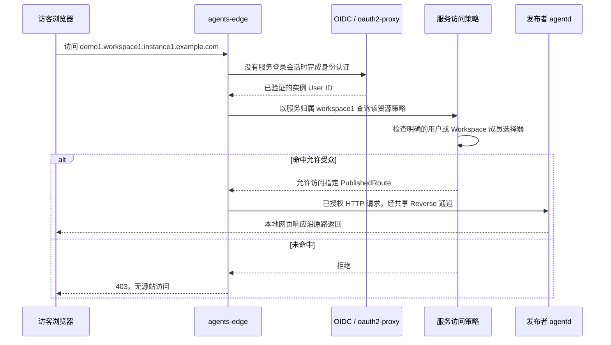
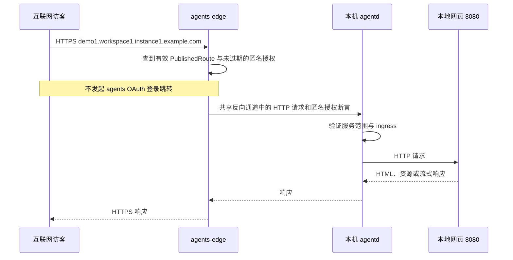
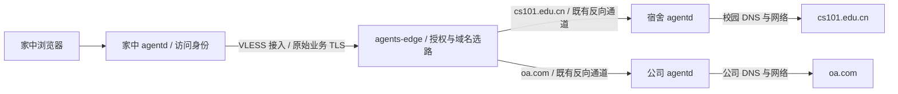

# agents / agentd 用户场景走查

基线更新：以下案例的服务受众和指定出口语义继续保留；旧 VLESS Reverse 接入、purpose 池和角色快捷命令属于历史方案。当前入口是本地 `config.yaml`，同一进程可组合 ingress、serve、egress；agents 管理认证、连接目录和业务流，XHTTP/WSS 仅作承载。具体配置见 [本地配置规范](agentd-config.md) 和 [完整示例](../examples/agentd/config.yaml)，Serve 公网请求统一先经过 gateway。

状态：设计走查，命令和输出为拟议接口，尚未实现。依据 [架构方案](agents-agentd-architecture.md) 与 [对齐审查](agents-agentd-alignment.md)。

2026-10-18 身份流程以 [Hydra Device Flow 与 User/SA 设计](https://github.com/Bit-Precise/agents/blob/main/docs/identity-and-device-flow.md) 为准：所有示例中的 `agentd login` 都表示同一二进制的标准 Device Flow；浏览器先认证人类，再选择 Workspace 和本人/该空间 SA，SA 仅 maintainer+ 可选择。服务器必须使用 SA，SA 可有多个 Agent 且不能登录 Console。下文若只写“用户身份”表示个人 profile，不涵盖服务器 profile；其他旧命令仍只是场景示意，不能当作已实现 CLI。

**Case 1：开发者发布本地网页，并选择哪些用户可以访问**

用户用 Codex 或其他工具完成网页开发，本地服务运行在 `http://127.0.0.1:8080`。发布后，为服务创建有期限的授权，对象可以是匿名访问者、单个用户或 Workspace 成员组。这些授权可以同时存在且分别到期。下面的三个受限分享例子需要访客登录，匿名授权例子无需登录。

假设资源属于 `workspace1`，发布名称为 `demo1`。三种范围都使用同一个地址：

```text
https://demo1.workspace1.instance1.example.com
```

首次使用先登录：

```text
agentd login --instance https://instance1.example.com --workspace workspace1
```

程序自动创建/恢复 AgentRegistration，并在发布时创建/复用提供方 Tunnel。用户只需选择服务和受众，不需要操作 Xray 配置。

**变体 1A：当前 Workspace 的用户访问**

```text
agentd serve --url http://127.0.0.1:8080 --name demo1 --expires-in 24h
```

省略受众参数，默认创建一条向 workspace1 成员组的授权，有效期 24 小时：允许其有效成员，包括 guest；不允许仅属于其他 Workspace 的用户。

```text
Published: https://demo1.workspace1.instance1.example.com
Access:    Members of workspace1
Login:     Required
Expires:   24 hours after publication
```

Workspace 加入/退出、成员暂停、用户禁用按照策略失效预算及时生效。访客不需要安装 agentd。

**变体 1B：只允许邮箱或用户名指定的用户**

```text
agentd serve --url http://127.0.0.1:8080 --name demo1 \
  --allow-user @alice \
  --allow-user bob@example.com \
  --expires-in 24h
```

这是另一种首次发布配置：只创建 Alice、Bob 两条 user 授权，本例都在 24 小时后到期，不隐式创建 Workspace 全员授权。没有列入的 workspace1 用户也不能访问；发布者若希望访问，应将自己包含进去。界面可以方便地勾选“包括我”，但管理角色不隐式绕过数据访问策略。

control 将 `@alice` 解析为实例内唯一用户名，将邮箱解析为唯一的已验证账号，并保存 User ID。用户名或邮件地址只是输入方式，不是运行时权限主键。

- 被指定用户可以属于 workspace1、其他 Workspace，或不属于任何 Workspace；前提是具备有效实例身份，且该分享符合来源 Workspace 的分享管理权限。
- 未注册邮箱先创建待验证邀请。对方按照实例的注册/登录规则建立身份并证明邮箱归属后，邀请绑定到 User ID 才生效；原先的授权截止时间不因接受邀请而顺延。
- 未知用户名、重名/歧义邮箱、空受众均报告错误，不能因此恢复成全员访问。
- 不因收到邀请就自动成为 workspace1 的 guest 或其他成员。

```text
Published: https://demo1.workspace1.instance1.example.com
Access:    Selected users: Alice, Bob
Login:     Required
```

**变体 1C：允许当前 Workspace 和另外一个 Workspace 的成员**

```text
agentd serve --url http://127.0.0.1:8080 --name demo1 \
  --allow-workspace workspace1 \
  --allow-workspace workspace2 \
  --expires-in 3d
```

这里创建两条 workspace 授权，本例均在 3 天后到期。有效期内按 `members(workspace1) OR members(workspace2)` 判断，成员资格按访问时的有效状态计算，不把当前成员列表复制成静态名单。同一实例以外的 Workspace 不在第一版范围。

workspace2 的用户仍访问 workspace1 下的原始服务地址。服务、IngressRule、Tunnel、agentd 和资源管理权全部留在 workspace1；不会在 workspace2 复制一个服务，也不会将两边的网络或隧道打通。

```text
Published: https://demo1.workspace1.instance1.example.com
Access:    Members of workspace1 OR workspace2
Login:     Required
```

从 workspace2 离开的用户失去这一授权来源；如果他仍是 workspace1 成员，或另外存在直接用户授权，仍可访问。控制台应能解释最终命中的授权来源。

**统一授权语义**

- 首次未指定受众：创建一条有期限的当前 Workspace 授权。
- 首次指定任何 `--allow-user` / `--allow-workspace` / `--public`：只创建显式列出的授权，不自动加入当前 Workspace。
- 匿名、指定用户和 Workspace 授权可以组合；只要命中至少一条当前有效且未撤销的授权，即有访问权。
- `--expires-in` 为本次批量创建的授权指定期限；控制台可对每条授权独立设置开始和截止时间。没有显式期限时只能使用 Workspace 配置的有限默认期限，不能生成隐式永久授权。
- `--public` 是添加匿名授权的快捷方式，不是排他的服务模式；可以与用户和 Workspace 授权共存。
- 已有服务可逐条新增、续期、撤销授权，也可显式原子替换整组授权。未批准的扩权保持旧授权，不产生临时公开窗口。

**访问时的统一流程**



Edge 不能在执行服务策略前就要求“必须属于 workspace1”，否则变体 1B 的外部用户和变体 1C 的 workspace2 用户会被错误拒绝。服务身份断言区分资源 Workspace 与访客全局 User ID，不伪造 Membership。

这些选择只改变服务的 AccessGrant 集合，使用同一个 PublishedRoute、源站和 Serve purpose 的反向通道池；分享对象增加不会新建 VLESS 连接池，也不授予对方管理面、其他服务或出口能力。Serve 与 Egress 首版使用不同 purpose 的通道池。

**发布者权限**

- owner/maintainer 可配置上述受众。
- developer 可管理自己服务在 workspace1 成员范围内的选择。
- 指定非 workspace1 用户或共享给 workspace2，需要来源 Workspace 的 `service.share.external` 权限；管理员可预先授予 developer，否则形成待批准变更。
- 分享不要求发布者成为目标 Workspace 的管理员，不授予查询目标 Workspace 完整成员列表的权利。
- guest 作为访客可以按策略访问，但不能发布或修改受众。

**受限分享的验收矩阵**

假设 Alice 仅属于 workspace1，Bob 仅属于 workspace2，Carol 仅属于 workspace3：

| 访问策略 | Alice | Bob | Carol | 未登录 |
|---|---|---|---|---|
| workspace1 成员 | 允许 | 拒绝 | 拒绝 | 进入登录 |
| 指定 Alice、Bob | 允许 | 允许 | 拒绝 | 进入登录 |
| workspace1 或 workspace2 成员 | 允许 | 允许 | 拒绝 | 进入登录 |

上表假定相关授权尚未到期。“进入登录”不等于登录后一定允许，认证完成后重新判断有效授权。只配置指定用户授权时，新加入 workspace1 的 Dave 仍被拒绝；存在有效 workspace1 授权时，他作为有效成员获得访问。

权限调整、跨 Workspace 成员变更、邮件验证、User ID 绑定、停止发布和跨租户管理面拒绝都需要测试。源站仍在用户本机运行，页面可访问性依赖源站、agentd 与反向连接正常。

**变体 1D：显式匿名公开（保留先前案例）**

用户已经用 Codex 或其他工具完成网页开发，本地服务正在 `http://127.0.0.1:8080` 运行。用户希望把一个 HTTPS 链接发给任何人，访客无需安装 agentd、加入 Workspace 或登录 agents。

前置条件：Instance 与 Workspace 已存在；管理员完成实例入口、Workspace DNS 和证书的基础配置；用户是有效成员。以下成功路径假定用户具有公开发布权限。按照当前角色矩阵，owner/maintainer 可以直接公开发布，developer 需要批准，guest 不可发布。

**用户操作**

首次使用只需登录并选择 Workspace：

```text
agentd login --instance https://instance1.example.com --workspace workspace1
```

浏览器完成登录，控制端验证用户的 Workspace 成员资格；本机自动创建/恢复 AgentRegistration，分配名称。后续执行发布：

```text
agentd serve --url http://127.0.0.1:8080 --name demo1 --public --expires-in 1h
```

`--public` 明确请求创建匿名访问授权，本例有效期 1 小时；没有显式受众时默认创建有期限的当前 Workspace 授权。普通流程不要求用户先手工创建 Tunnel、编辑 Xray 配置或运行多个隧道命令。`--tunnel` 保留为选择已有 Tunnel 的高级参数；未指定时程序为当前提供方注册身份创建或复用默认 Tunnel，仍由控制端校验授权。

只有路由、证书、本地源站与反向连接均就绪后，才输出可用链接。示意输出：

```text
Published: https://demo1.workspace1.instance1.example.com
Access:    Public — no agents login required
Origin:    http://127.0.0.1:8080
```

如果需要等待批准或证书，输出对应的 pending 状态，不把预留的 URL 表示为已经可用。

**后台动作与实体变化**

| 时机 | 系统动作 |
|---|---|
| 首次登录 | 创建/恢复 AgentRegistration，验证 User + Membership |
| 请求公开发布 | 检查资源创建权和公开发布权，预留 Workspace 内唯一的 `demo1` 名称 |
| 建立提供方 | 创建/复用 Tunnel 与 AgentTunnelBinding，启动 Connector 和对应 purpose 的 VLESS Reverse 连接池 |
| 写入配置 | 创建 PublishedRoute，指向 Tunnel；创建匹配该 hostname 的 IngressRule，源站为本地 8080；保留最终兜底规则 |
| 设置访问 | 经批准为该 PublishedRoute 创建 1 小时匿名 AccessGrant，记录审计 |
| 生效 | agentd/Edge 确认同一配置 revision，证书和反向路径检查成功后激活路由 |

用户不必了解上述实体才能完成发布。一次发布不会开启 egress，也不会创建客户端 HTTP/SOCKS/TUN 代理。

**访客请求**



公网浏览器的 TLS 在 Edge 终止，本地源站可以继续只监听 loopback HTTP。Edge 仍检查 Workspace、Tunnel、路由是否有效，并对 agentd 提供服务范围内的短期匿名授权断言；public 并不绕过平台内部的路由与隔离。应用自身的登录机制不受 agents 的公开设置影响。

不要求开发者有公网 IP、在路由器上开入站端口，或让访客安装客户端。本地网页进程、agentd 及到平台的网络连接需保持运行；本案例是访问转发，未上传或托管网页构建产物。

**权限分支**

- owner/maintainer：明确使用 `--public` 后直接生效。
- developer：按当前默认权限形成公开申请。批准前不允许匿名访问；如果已建立成员可访问版本，可以明确显示它是 private，不能把它当作用户请求的公开结果。
- guest/非成员：拒绝创建发布；不会先创建可访问的公网路由再补做权限判断。
- 未显式传 `--public`：保持 members-only，访客按现有私有服务登录流程访问。

公开发布由 `service.publish.public` 管理权限控制。Workspace 管理员可以预先授予 developer 自助公开自己服务的权限，否则仍需批准；服务默认保持 members-only。这与跨 Workspace 分享的 `service.share.external` 是两项不同权限。

**失败与停止行为**

- `demo1` 名称被其他资源占用：返回冲突并给出可选名字，不覆盖已有服务。
- 本地源站未启动：在激活前尽可能检查并报告；运行中失效返回 502/504，不改连其他本地端口。
- DNS/证书未就绪：显示发布等待状态。
- agentd 离线或没有可用 Connector：Edge 返回 503，保留名称以便恢复；不回落到其他 Agent。
- 用户显式停止该发布：停用 PublishedRoute、拒绝新访问，并按策略关闭活动流；其他共享同一 Tunnel 的发布继续工作。
- 前台运行方式退出时，需要明确显示发布已停止或连接已离线；后台守护方式则通过显式停止发布操作结束，不能让用户误以为关闭 CLI 窗口就必然撤销后台服务。

普通 HTML、相对路径资源、API、SSE 与 WebSocket 都需要通过发布入口工作。开发服务器的 Host/Origin 校验和 HMR 地址需要相应配置；不能假设代理会自动改写页面脚本里硬编码的 `localhost` 地址。

**本案例验收**

1. 有权限的用户登录后，一条 serve 命令得到正确的 HTTPS 链接和明确的授权截止时间，无需手动操作 Tunnel/Xray。
2. 未登录、没有 Workspace 账号的访客可访问明确公开的页面，且不会进入 oauth2-proxy 登录流程。
3. 未传 `--public` 时仍保持成员访问要求；无权公开的 developer 不能自行绕过审批。
4. 访客只能访问指定源站，不能借此访问本机其他端口或其他 Workspace。
5. 页面资源、SSE/WebSocket 正常；本机离线、源站停止、发布撤销分别具有可辨认的行为。
6. 整个场景不启用出口、客户端代理或 TUN；多个发布复用同一 Serve purpose 的提供方反向通道池。

**变体 1E：同一服务的授权分别到期**

假设显式配置以下三条授权，没有额外的默认 Workspace 授权：

| 对象 | 权限 | 自发布开始的有效期 |
|---|---|---|
| 匿名访问者（任何人） | 访问 demo1 | 1 小时 |
| Alice | 访问 demo1 | 7 天 |
| workspace2 的有效成员 | 访问 demo1 | 3 天 |

- 第 1 小时内：任何人可访问。
- 第 1 小时到第 3 天：需要登录，Alice 或 workspace2 的有效成员可访问。
- 第 3 天到第 7 天：只有 Alice 可访问。
- 第 7 天到期：没有有效授权，拒绝访问；管理员仍可管理服务或重新授予权限。

到期使用 `starts_at <= now < expires_at` 判断。已有登录 Cookie 不延长授权；Edge 不等待后台清理任务才拒绝新请求。WebSocket、SSE 与下载在授权到期后重新检查，若没有其他可用授权则结束该业务流，保持其他服务共享的隧道连接。匿名建立的会话若没有已验证用户身份，需要重新登录才能使用定向授权。

新增、续期、撤销都针对某条授权，按权限检查并审计；延期不是刷新登录会话。邮件邀请验证不顺延既定截止时间。撤销所有授权后，不自动恢复成当前 Workspace 全员或匿名访问。已到期的缓存/JWT 不能继续放行，已下载的页面内容则无法撤回。

**Case 3：家中笔记本分别通过宿舍和公司 agentd 访问两个网络的服务**

用户在家中浏览器访问 `https://cs101.edu.cn`，请求应从宿舍笔记本发出；访问 `https://oa.com` 时，应从公司电脑发出。两个目标网站的 TLS 都保持端到端，网站本身的登录仍正常执行。

本案例先假定三个 agentd 注册在同一个 Workspace `workspace1`；用户有访问两条出口规则的限时授权。该设定不要求三台机器形成 IP 网络或相互拥有可路由的私网地址。

| 机器 | 注册名称 | 本案例角色 |
|---|---|---|
| 家中笔记本 | `home.workspace1.instance1.example.com` | 访问客户端，提供本机 HTTP CONNECT/SOCKS5，或可选 TUN |
| 宿舍笔记本 | `dorm.workspace1.instance1.example.com` | 已批准的 TLS 出口，能访问校园服务 |
| 公司电脑 | `office.workspace1.instance1.example.com` | 已批准的 TLS 出口，能访问公司服务 |

**准备出口与规则**

宿舍和公司 agentd 分别完成注册、开启出口、通过 Workspace 审批，并主动建立各自的共享 VLESS Reverse 通道池。它们不需要开放公网入站端口。管理员配置：

| 规则 | 目标与端口 | 指定出口 | 授权对象 | 示例期限 |
|---|---|---|---|---|
| campus-cs101 | `cs101.edu.cn:443`，TLS | dorm | 当前用户 | 7 天 |
| company-oa | `oa.com:443`，TLS | office | 当前用户或 workspace1 成员组 | 8 小时 |

每条规则是一个 EgressRoute，拥有独立的 `egress.use` AccessGrant。规则本身存在或用户属于 Workspace，不代表自动有使用权。期限也不是启用出口功能的永久开关。

宿舍/公司 Agent 的允许目标范围与规则一致。若校园或公司 DNS 解析结果属于私网，配置时需明确批准对应域名可以连接的目标地址范围；这不向家庭电脑发布该网段的任意访问能力。

**公司出口允许 oa.com、拒绝 git.com**

在 office 的出口能力配置中设置目的地策略：

| 目标 | 公司出口行为 |
|---|---|
| `oa.com:443` 的 TLS | 在用户拥有有效路由授权时允许 |
| `git.com` | 明确拒绝，用户授权不能覆盖 |
| 其他域名、端口或未获准 IP | 默认拒绝 |

规则使用明确的域名 exact/suffix 匹配。若以后添加更宽的域名允许范围，仍保留对 git.com 的显式拒绝；如果拒绝要覆盖其全部子域名，使用包含该域的 suffix 拒绝项。单独允许 oa.com 不隐式允许所有子域名。

Edge 在选择公司出口后检查这份约束，拒绝的请求不进入公司反向通道；公司 agentd 在实际拨号前使用已批准规则与本地限制的交集复核。增加 `git.com → office` 路由或给用户增加 `egress.use` 授权都不能覆盖目标拒绝；必须由有权管理出口策略的人显式修改相应限制。

拒绝时不能自动尝试宿舍或家庭直连。公司出口的 git.com 限制不自动成为其他出口的全局规则；若整个 Workspace 都需禁用该目标，将拒绝策略提升到 Workspace 层。

**家中用户的操作**

拟议 CLI：

```text
agentd login --instance https://instance1.example.com --workspace workspace1
agentd access proxy --workspace workspace1 \
  --http 127.0.0.1:8088 --socks 127.0.0.1:1080
```

浏览器使用本地代理，访问的仍然是真实网站域名。代理请求携带域名，例如 HTTP CONNECT 的 `cs101.edu.cn:443`；无需将浏览器 URL 改成 agentd 的名称或服务发布域名。下面用标准 curl 验证 SOCKS 入口（需要前述拟议程序实际实现后才能执行）：

```text
curl --proxy socks5h://127.0.0.1:1080 https://cs101.edu.cn/
curl --proxy socks5h://127.0.0.1:1080 https://oa.com/
```

HTTP CONNECT / SOCKS 域名请求可以避免家庭机器提前解析目标。家中 agentd 的控制地址和 Edge 接入地址仍需能正常解析与连接。

**两条请求的转发**



1. 家中 agentd 通过有效 ClientSession 身份将业务交给 Edge。
2. Edge 识别 Workspace 与用户，读取业务 ClientHello 的可见 SNI，核对请求目标、匹配路由，并检查授权期限。
3. `cs101.edu.cn` 只选 dorm 的已批准 Tunnel Binding 与当前 Connector；`oa.com` 只选 office。两条业务可以并发，用户不必每次手动切换出口。
4. 出口 agentd 在各自的网络中解析对应域名，检查解析结果，并创建到目标的 TCP 连接。公司内部 DNS 由公司出口使用，校园 DNS 由宿舍出口使用；不强制改成公共 DNS。
5. 原始 TLS 握手与密文沿链路透传。目标看到的连接来自相应出口网络；家庭浏览器看到的仍是目标网站证书。

家庭侧的普通 VLESS 访问连接与两台提供方的 Reverse 通道属于不同角色。宿舍/公司分别有自己的 provider Connector；同一条 provider 反向承载连接可以同时承载 Egress 和 Serve 逻辑流，但每条流必须使用独立的 purpose capability 和撤销句柄。多个目标规则可以共享同一承载连接。

**授权、期限与失败行为**

- 家庭用户只授权了 campus-cs101 时，访问 oa.com 被拒绝，即使公司 Agent 在线。
- company-oa 的 8 小时授权到期后，新的 OA 访问被拒绝；活动流重新检查后没有其他有效授权则关闭。7 天的校园授权继续生效。
- dorm 离线时，校园请求失败，不改走 office 或家庭直连；OA 请求仍正常。
- office 离线时反之。不得因为两边都注册在同一 Workspace 就任意互作出口。
- 目标网站重定向到 SSO 域名、或页面访问其他 API 域名时，新的 TLS 连接需要相应的出口规则和授权；不会因为主域获准就自动放开所有相关域名。
- 仅有规则和 Agent 在线不能保证校园/公司网络本身允许访问，目标服务的账号、证书与网络限制仍需正常满足。
- 原始 TLS 无 SNI、ECH 或目标/SNI 不一致时，按架构文档的严格规则处理；不声称可以看到 ECH 内部域名。

可选 TUN 仍走相同决策，只替代本机代理入口，不分配校园/公司网络的 Overlay IP，不提供任意 IP/端口访问。业务端仍按域名与获准的 TLS 端口选路。

如果宿舍和公司属于不同 Workspace，第一版分别使用对应 Workspace 的客户端 profile/本机代理入口；一个 TUN 只激活一个 Workspace。不能根据 SNI 在用户多个 Workspace 间偷偷合并权限。若需要一个代理入口同时使用多个 Workspace，应另行定义显式的 profile 路由与授权组合，本案例不默认提供。

**本案例验收**

1. 家庭客户端并发访问两个域名，分别从正确的出口访问；包括目标在两个网络具有不同或重叠私网地址的情况。
2. 目标 DNS 在正确的出口网络解析，家庭端不需要获知校园/公司私网解析结果。
3. 客户端验证目标原证书，ClientHello 和后续业务 TLS 字节不被代理终止或篡改。
4. 无授权、授权到期、错误 Workspace、出口离线、DNS 不在允许范围时拒绝，不发生错误出口回退。
5. 单条规则到期/撤销不会停止其他有效路由或整个共享通道池。
6. 整个访问流程不触发网页 oauth2-proxy 重定向；用户身份在客户端会话中提前取得，校园/公司站点自己的登录仍可正常执行。
7. office 明确拒绝 git.com 时，有效用户、有效使用授权或新建路由都不能产生到 git.com 的出口拨号；Edge 与 agentd 分别验证拒绝优先和无错误回退。
