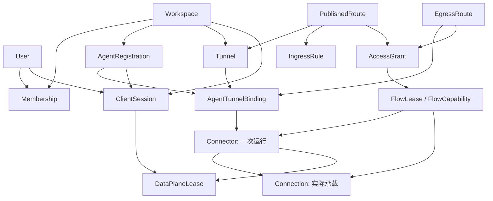
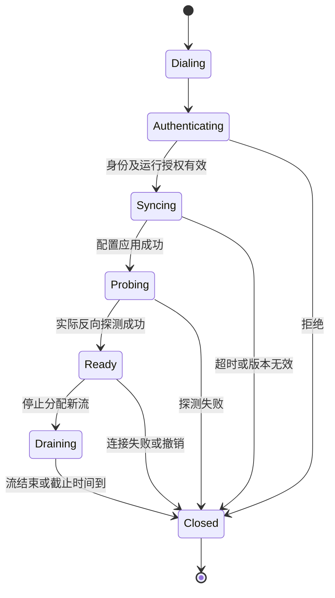

# agents / agentd 详细审阅

审阅后的决策：已确认由 agents 管理认证、连接目录和业务流，XHTTP/WSS 只负责承载；新增本地三角色 `config.yaml`。本文保留审阅时的发现与行号，当前设计以 [架构方案](../agents-agentd-architecture.md) 和 [本地配置规范](../agentd-config.md) 为准。

日期：2026-10-17。审阅范围：本目录全部六份设计文档、`poc/xray-reverse` 配置与脚本，以及调研固定版本的 Xray、Headscale 相关源码。`agents/`、`agentd/` 尚无产品源码；文中的缺口不等于已经发生的产品漏洞。本文记录审阅结果和建议，不替代原设计或宣称功能已实现。

本轮新增验证：13 份 Xray 配置的 `xray run -test` 均通过；在随机 loopback 端口隔离复现了访问端凭据注册反向 worker。原 README 的其他实验结果作为既有记录引用，本轮没有全部重跑。没有执行真实 CDN、OIDC、产品路由和状态机联调。

**1. 总体结论**

持久身份、逻辑 Tunnel、运行实例、承载连接、访问会话与业务流的分层是合理的。最大问题是产品语义尚未落实到承载层：Edge 在业务上选定 Connector，不代表 Xray 的共享 Reverse 池会选择它；删除用户不代表停止旧连接上的新流，也不代表终止已有流。

现有文档已经意识到这些问题并提出 FlowLease、PolicyGate、capability，但仍缺少消息协议、原子性、代际隔离、续期和关闭语义。因此不能把现状评价为“安全链路基本完成，只差管理界面”。

结合后续讨论，推荐调整实现边界：**agents 自己持有经过认证的 provider 连接、连接目录和业务流；XHTTP/WSS 只提供承载能力。** 不再让 Xray Reverse、VLESS 用户表与 route tag 代替产品实体。设备认证采用 OIDC 引导注册及后续设备凭据；信任 CDN 且使用 HTTPS 回源时，两段 TLS 足够，不要求增加内层加密。

**2. 实体及其关系**

依据：[架构实体定义](../agents-agentd-architecture.md) 第 160–221 行、注册流程第 274–294 行、[P0 修复方案](agents-agentd-p0-remediation.md) 第 26–60 行。

| 层次 | 实体与关系 | 应保持的语义 |
|---|---|---|
| 租户与人员 | Instance → Workspace；User 通过 Membership 加入多个 Workspace | 用户是实例级身份；角色属于 Membership，不属于设备或域名 |
| 持久设备身份 | Workspace → AgentRegistration | 一个安装/profile 的稳定身份与名称；设备身份不等于当前登录用户 |
| 提供方授权 | AgentRegistration ↔ AgentTunnelBinding ↔ Tunnel | 多对多批准关系；默认一对一只是使用约定 |
| 运行实例 | Binding → Connector → 多条 Connection | Connector 表示一次提供方运行；Connection 表示承载连接，不是单次 XHTTP 请求 |
| 访问会话 | User + Workspace + AgentRegistration → ClientSession | 纯访问端不需要 Tunnel/Connector；同一进程兼任提供方和访问方时分别认证 |
| 工作凭据 | Connector 或 ClientSession → DataPlaneLease | 解决传输接入身份；不是资源访问授权 |
| Web 发布 | PublishedRoute → Tunnel；Route 关联 IngressRule | 公网 hostname 定位服务；匹配规则从已批准配置选择本地源站 |
| 域名出口 | EgressRoute → AgentRegistration + Tunnel/Binding | `via` 指定逻辑 Agent，不允许静默替换为同 Tunnel 的其他 Agent |
| 授权 | PublishedRoute/EgressRoute → AccessPolicy + 多条 AccessGrant | 强制拒绝优先；有效 Grant 按并集判断；Web 分享不改变资源归属 |
| 运行期业务 | FlowLease + FlowCapability → 实际 Connector、资源、目标和期限 | 每次 HTTP 请求或长流独立授权、审计、续期和关闭 |



必须补齐的约束：Connector 的 Workspace、AgentRegistration、Tunnel 必须共同引用有效 Binding；DataPlaneLease 的主体应明确为 Connector 或 ClientSession 二选一；资源关联使用 Workspace 组合约束。跨 Workspace 的 Web Grant 主体是分享例外，不是跨租户 Tunnel/出口引用的例外。

所有稳定名称引用最终都应保存 UUID。Agent 名称不直接用于拨号，也不自动成为 Web 服务入口。Registration 凭据目前是可复制 bearer，因此 `via` 指向逻辑注册身份，并不保证唯一物理机器。

**3. 状态机：需要拆成多个相互约束的状态轴**

下面是建议规范，尚未实现。不能用一个 `online` 同时表示“注册合法、控制通道正常、配置已生效、反向通道可用、允许接新业务”。

| 对象 | 建议状态迁移 | 关键约束 |
|---|---|---|
| AgentRegistration | pending → active → suspended/revoked | 暂停与永久撤销分开；恢复须有明确凭据/代际规则 |
| Binding/能力 | declared → pending_approval → approved → withdrawn/revoked | Serve/Egress 能力独立，不互相授予 |
| ControlSession | disconnected → authenticating → syncing → live → degraded/expired | 控制面恢复后同步完整快照，不能仅恢复心跳 |
| Connector | starting → synchronizing → ready → degraded/draining → stopped | 进程重启新建 Connector；fenced 的旧运行不能复活 |
| Connection | dialing → authenticated → probing → ready → draining → closed | 通过实际反向探测才能 ready；重连使用新连接代际 |
| DataPlaneLease | allocated → installed → delivered → active → expired/revoked | Edge 安装 ACK 后才交付；刷新不延长已撤销权限 |
| 配置 | desired → approved → issued → staged → applied → healthy → active → retired | ACK 区分收到、应用、健康；失败进入 failed |
| FlowLease | authorizing → reserved → opening → active → closing → closed | 拒绝/关闭为终态；半关闭另记两个方向的状态 |



重连由 supervisor 创建新的 Connection，采用带随机抖动的退避。上图不表示关闭后的旧连接可以恢复为同一个有效会话。

某 purpose 可接收新流的条件应至少为：

```text
Registration、Workspace、Tunnel、Binding 均有效
AND 该 purpose 获批
AND 策略/会话/凭据未过期
AND 对应配置 revision 已应用
AND 至少一条实际探测成功的 Connection
AND Connector 未 draining/fenced
AND 配额允许
```

一条 Connection 断开不等于整个 Connector 离线；控制心跳正常不等于数据面 ready；Egress 被撤销不等于 Serve 必须停止。源站健康也应独立表达，不能把某个源站 502 变成整个 Agent 离线。

**4. 必须明确的断线、更新和撤销语义**

1. **进程重启与并发运行。** Registration/Tunnel 保持，Connector 更新。选择“允许同 Registration 多实例”或“单活动运行”，后者必须由服务端授予 `run_epoch`，旧 heartbeat/ACK/续租不能复活旧运行。软件私钥也可能被复制，不能等同硬件唯一身份。
2. **连接断开。** 从可分配目录移除连接；已发送业务数据的流失败，不自动重放。HTTP 非幂等请求和已有 TLS 会话尤其不能迁移重放。
3. **Edge 重启。** 原内存流表失效，旧流终止；旧 payload 不能挂到重启后的新 flow_id。重新接入必须绑定新的 Edge/会话代际。
4. **配置激活。** Serve 涉及 gateway、Edge、实际被选 provider，不能只收 agentd/Edge ACK。ACK 应包含运行代际、revision、配置摘要与应用结果；只有相容配置可被路由选中。
5. **权限收紧。** 先安装准入屏障，再撤销/重评旧流。授权检查与流表登记必须处于同一 policy epoch，否则撤销扫描可能漏掉稍后登记的流。
6. **主动排空。** 先禁新流，再处理旧流；权限撤销不能用优雅排空延长授权。Xray 自带 draining 不是严格禁新流开关。
7. **控制面失联。** 允许在既有绝对截止时间内运行；不得用本地重签/刷新将旧策略重新延长。15 秒心跳、5 分钟工作凭据、60 秒策略陈旧、15 秒缓存是不同预算，不能互相替代。
8. **授权并集。** 撤销某个 Grant 时重算原 principal 的授权集合；仍获准则续签同一流，未获准才关闭。匿名流不能自动变成 Alice 的流。

建议业务协议明确 `OPEN/OPEN_ACK/RENEW/CANCEL/CLOSED`，续签使用单调序号；迟到 OPEN/RENEW 不能复活已关闭流。CANCEL 必须幂等，先到 CANCEL、后到 OPEN 的情况需要短期终态记录。会话和流过期由本地定时器执行。

每次许可的绝对截止应受 Grant、用户会话、策略快照、相关凭据及流自身 TTL 的有效上限约束；如果允许通过轮换继续长流，须重新授权并续签。尚未确定这些规则前，不能给出可信的断网撤销时延承诺。

**5. Serve 的正确选路**

```text
浏览器 → agents-gateway → agents-edge
       → 指定 Connection 上的 provider agentd → 已批准本地源站
```

1. Gateway 终止浏览器 HTTPS，逐请求规范化 Host/`:authority` 与 path，查找已激活 PublishedRoute。
2. 用统一编译的 matcher 选定该 Route 允许的 IngressRule。规则按顺序 first-match；最终兜底应明确为拒绝，不能跨服务落入另一个源站。
3. 认证访客并检查资源策略与有效 Grant。存在匿名授权时无需登录；直接 User/其他 Workspace 授权不要求访客加入资源 Workspace。
4. Gateway 向 Edge 提交绑定主体、资源 Workspace、Route、IngressRule、host/path、revision、期限的授权结果。建议称为 `ServeAdmission`。
5. Edge 验证内部服务身份和授权结果，按 `PublishedRoute → Tunnel → 该 purpose/revision 下 ready 的 Connector` 选提供方。
6. Edge 将 FlowLease 原子登记，生成绑定最终 Connector、连接代际、流 ID 的 `FlowCapability`，在**已选定的真实连接对象**上开流。
7. Agentd 验证 capability，只从同 revision 的批准配置取源站 URL；不得从外部 target 自由拨号。身份断言与平台 Cookie 不交给源站。
8. 上下行保持同一流归属。HTTP keep-alive 每个请求重新授权；WebSocket/SSE/下载进入活动流账本并处理到期/撤销。

Gateway 先授权、Edge 后选 Connector，因此两阶段凭证必须明确；不能在签名后给同一 token 随意补 Connector 字段。新凭证不得扩大原授权作用域或期限。

Serve 允许在 Tunnel 的等价副本之间为**新请求**选择提供方；这与 Egress 指定单一 Agent 的语义不同。

**6. Egress 的正确选路**

```text
应用 → 本地 agentd 的 CONNECT/SOCKS/TUN → agents-edge
     → EgressRoute 指定 Agent 的连接 → 出口本地 DNS/拨号 → 目标网站
```

1. Edge 根据经过认证的访问会话确定 User、Workspace 和 purpose；SNI、路径、email、target 都不能决定身份。
2. 代理协议通常在客户端 agentd 被消费，Edge 收到的是传递的目标元数据及业务字节，不应假设原始 CONNECT/SOCKS 握手自动完整保留。
3. 规范化域名、端口和协议，有限读取 ClientHello。严格 SNI 模式要求目标域名与 SNI 一致；地址目标、无可用域名、无法解析、ECH 按明确规则拒绝或进入显式 authority 模式。
4. 先根据 priority、exact/suffix 和具体度选定唯一规则，再检查 `egress.use`；失败直接拒绝，不继续尝试更宽规则。priority 的数值方向还需在规范中固定。
5. 有效允许范围是实例/Workspace 约束、规则、批准出口能力及 agentd 本地限制的交集，适用的显式 deny 优先。
6. 将 `via` 解析成 Registration UUID，验证它的 Binding，然后筛选该 Registration 的 ready Connector。不能只用 Tunnel ID 选择任意 worker。
7. 原子登记 FlowLease，签发绑定 canonical destination、资源、Connector、代际、revision 和期限的许可，在选定连接上 OPEN。
8. 出口复核后在自己的网络解析域名，检查解析结果，并用**同一份结果**拨号。域名是授权主键，解析地址是拨号安全检查，不成为跨租户网络路由。
9. 已缓存 ClientHello 完整重放，后续目标 TLS 字节保持不变。流建立元数据由 agentd 消费，不能送进目标网站的 TLS payload。

CONNECT/SOCKS 还有一个时序缺口：应用一般等代理成功响应后才发送 ClientHello。若代理又等 SNI 决策后才返回成功，就会互相等待。应区分“代理承载已建立”和“目标授权/拨号成功”，明确提前成功响应、后续拒绝关闭、检查超时和错误可见性。

出口离线、权限拒绝、策略过期、域名不一致均不允许回退到 Edge 直连、家庭直连或其他 Agent。拒绝与不可用应返回可区分的错误。

**7. 按优先级排列的发现**

P0 在这里表示实现/发布阻断项，不代表仓库已部署了一个有漏洞的产品。

| 编号 | 优先级与证据类型 | 发现、影响与处理 |
|---|---|---|
| F1 | P0，PoC 实测 | **access-client 凭据可以注册反向 worker。** `portal-ws.json:42` 将 external/interconn 同送 portal；保留目标可触发 provider 分支。应成为独立负向验收，不可把该配置投入共享部署。 |
| F2 | P0，源码证明 | **共享 Reverse 池不按 Connector 选路。** `PickAvailable()` 不接收 Connector，按 worker 负载选择。多个不等价 Agent 共池无法兑现 via；错 Agent 拒绝 capability 只能避免误拨，不能保证可达。推荐自己持有连接并直接选连接。 |
| F3 | P0，既有实测及源码 | **RemoveUser 不等于撤销业务。** 应区分禁止后续认证、禁止已有连接上的新流、关闭旧流三步。P0 修复方案第 18–22 行把前两者合写，需修正。 |
| F4 | P0，条件性源码故障 | **新旧 UUID 共用 reverse tag 时，删旧用户可能删除新池映射。** RemoveUser 按 tag 删除 handler，没有按凭据代际的引用保护；旧流又未必关闭。若继续用 Reverse，tag 至少包含凭据代际，先建新池、切换目录、排空旧池。未动态复现此轮换场景。 |
| F5 | P0，设计缺口 | **开流、撤销、续期与关闭协议未闭合。** 授权检查后撤销扫描先完成、请求再登记，可形成漏关；需原子准入屏障、代际复核、终态防复活。 |
| F6 | P1，验证范围 | **PoC 测的是 bridge/portal，不是账户级 VLESS Reverse。** 固定源码与执行二进制也不同，不能把 HTTP 穿隧道成功当成新身份机制、完整 TLS Egress、CDN 或 SDK 已验证。 |
| F7 | P1，设计缺口 | **运行代际与配置 ACK 未定义。** runtime/Connection/snapshot generation 含义混用，gateway 未进入 ACK 流程；同 Agent 并发 Connector 的语义缺失。 |
| F8 | P1，设计缺口 | **capability 承载与委托关系未定义。** Gateway 先签、Edge 后选 Connector；Egress 需要内部 OPEN 元数据，原生 VLESS/Mux 不自动提供。架构第 508 行仍把出口独立验证用户描述成未来能力，与新 capability 要求需统一。 |
| F9 | P1，语义冲突 | **单 Grant 撤销不能一律 revoke 整个资源。** 修复方案第 62 行与主架构的授权并集冲突；须按原 principal 重评、续签或关闭。 |
| F10 | P1，隔离和可用性 | **Workspace runtime 重建会中断其他有效流。** 这是安全失败关闭的可用性代价，不能同时无条件承诺单规则撤销完全不影响其他流；正常撤销应关闭子流，应急重建单列。 |
| F11 | P1，规范缺口 | **Ingress 归属、目标规范化和 DNS 安全检查尚无可执行规范。** Gateway/Edge/agentd 必须消费同一匹配结果；私网出口需求不宜一概禁止私网，应明确批准域名的解析范围及本地约束。 |
| F12 | P1，未验证能力 | **登录 broker、真实 CDN、背压与流关闭没有端到端证据。** 文档已提出原则；还需真实链路和压力测试，不能通过 JSON 校验替代。 |

F2/F4 的固定源码证据：

- [StaticMuxPicker](https://github.com/XTLS/Xray-core/blob/0f127f934c6d7c10e4bb6acbe98033db9e5fd922/app/reverse/portal.go#L175)：无目标 Connector 参数；第 198 行之后还会在找不到非 draining worker 时重新选择 draining worker。因此严格禁新流必须由 Edge 实施。
- [VLESS GetReverse / RemoveReverse](https://github.com/XTLS/Xray-core/blob/0f127f934c6d7c10e4bb6acbe98033db9e5fd922/proxy/vless/inbound/inbound.go#L191)：按 tag 共用和删除 handler；第 243 行 RemoveUser 调用 RemoveReverse。
- [WorkerPicker 接口](https://github.com/XTLS/Xray-core/blob/0f127f934c6d7c10e4bb6acbe98033db9e5fd922/common/mux/client.go#L44)：没有 Connector 约束参数。

F1 的本轮复现方法：使用 Homebrew Xray 26.3.27；基于 WS 三份配置生成临时副本并改为随机 loopback 端口；rogue bridge 改用 external 用户 UUID、external 端口和 `/external` 路径，保留 `reverse.proxy`；**不启动合法 provider**。启动本地测试 origin，客户端经 SOCKS 请求，curl 退出码 0，收到 `REVERSE_THROUGH_ACCESS_CLIENT_CREDENTIALS`。实验进程、监听和临时目录均已清理。它证明当前 PoC 的角色边界可绕过，不证明尚未实现的产品或账户级 VLESS Reverse 有同样漏洞。

其他需修正文档的事项：

- 架构第 97/101 行、用户案例的 Serve 图仍让 Edge 执行浏览器入口职责；主架构第 124/319 行则已改为 gateway。第 306 行反向连接图也应指向 Edge。
- `NameReservation` 第 184 行仍称 Tunnel 名与服务名共享空间；第 266 行已改为 AgentRegistration 与服务名共享 label，Tunnel 管理名独立。
- 用户案例第 120 行称 Serve/Egress 独立 purpose 池，第 338 行允许共用连接；应统一物理复用与逻辑隔离语义。
- 多 Edge 目录将 Connector 写成单 owner，但 Connection 自带 edge_id；未来应明确 owner 属于连接还是整个运行实例。首版单 Edge 不受此歧义影响。
- 现有 PoC 证书路径硬编码；hold_server 无超时且每连接开线程；socks_probe 无确定结束与完整响应断言。这些是演示脚本，尚不是撤销时延自动化验收。
- 测试 UUID、私钥和 listener 都用于 loopback PoC，不应据此报告成生产秘密泄漏。

**8. Xray 与自有协议的取舍**

| 路线 | 判断 |
|---|---|
| 深度修改 Xray Reverse/Mux/用户和路由生命周期 | 能做，但要长期维护与产品实体强耦合的适配，当前需求下成本偏高 |
| 只复用 XHTTP，agents 自己管理会话与流 | 值得验证；保留 HTTP 承载价值，剥离 Reverse 语义 |
| WSS + 成熟多路复用库 + agents 协议 | 推荐作为最小可运行基线；真实 CDN 若不能满足，再增加 XHTTP 模式 |

自有协议主要定义认证、READY、OPEN、资源与目标、续期、取消、关闭；不需要自研加密。多路复用也优先复用成熟库，避免自行实现公平调度、窗口、RESET 和所有异常路径。

XHTTP 可以直接调用 [Dial](https://github.com/XTLS/Xray-core/blob/0f127f934c6d7c10e4bb6acbe98033db9e5fd922/transport/internet/splithttp/dialer.go#L293) 和 [ListenXH](https://github.com/XTLS/Xray-core/blob/0f127f934c6d7c10e4bb6acbe98033db9e5fd922/transport/internet/splithttp/hub.go#L443)，上游测试直接交换字节，不要求 VLESS/Reverse。但它不是独立稳定 SDK：仍依赖 Xray 根 module，listener 不直接暴露标准 http.Handler。

还需处理其具体生命周期：`splitConn` 的 deadline 方法是 TODO；部分 HTTP 请求使用 `context.WithoutCancel`；关闭 listener 不保证关闭所有连接。不能因为接口实现 net.Conn 就假定超时、取消、半关闭均已可靠工作。该固定 commit 的独立编译和运行本轮未验证。复用或抽取代码应保留 MPL-2.0 相关义务。

**9. TLS、设备认证与 CDN：按讨论后的信任模型简化**

```text
agentd ── HTTPS/WSS ── CDN ── HTTPS/WSS ── agents-edge
          TLS 第一段            TLS 第二段
```

本方案信任 CDN 终止 TLS、处理并转发平台协议；两段均有服务端证书验证即可承担传输保密与完整性，不要求再加 TLS/Noise。目标 Egress 网站原本的 TLS 仍按业务需求原样透传，这与是否额外加密 agents 通道是两件事。

普通 HTTP CDN 不会把 agentd 的外层 TLS 握手直接传到 Edge。因此设备认证有两个选择：

- **更通用的起步方案：** agentd 完成 OIDC 引导注册，服务端校验 Membership/注册权限后签发限定 Registration、Workspace、角色及期限的会话凭据；在 HTTPS/WSS 请求或首个应用握手中提交，Edge 自己验证。长期注册凭据和短期访问会话仍分开，提供方不绑定员工的永久登录状态。
- **CDN 支持的外层 mTLS：** 本地生成私钥与 CSR，注册批准后签客户端证书；CDN 验证客户端证书，再通过受保护的回源链路转交经过验证的身份。Edge 只接受可信 CDN 来源，不能信任用户自带身份头。CDN 到源站的 mTLS 本身认证的是 CDN，不是 agentd。

客户端证书的公开内容不是持钥证明；把证书放进 HTTP 头不等同 mTLS。如果未来要求 Edge 直接验证设备私钥，可另加成熟的请求/挑战签名认证，但这不是当前传输加密的必要条件。证书或 Token 认证成功仍不能代替每条 Serve/Egress 的资源授权和撤销。

Headscale 可借鉴本地密钥、注册批准和设备生命周期。其实际模型使用 MachineKey/NodeKey 与 Noise，并非可直接复用的 X.509 设备证书服务。仅为设备注册没有必要引入 WireGuard/IP Overlay；原生 WireGuard 不走普通 HTTP，但 DERP 存在 HTTPS/WS 中继路径，不能把所有 Headscale/Tailscale 链路一概说成无法穿 CDN。

相关官方说明：[客户端证书转发及验证](https://developers.cloudflare.com/ssl/client-certificates/forward-a-client-certificate/)、[源站认证](https://developers.cloudflare.com/ssl/origin-configuration/authenticated-origin-pull/)、[Headscale 注册](https://headscale.net/stable/ref/registration/)。具体 CDN 的 mTLS/自有 CA 支持可能受产品和套餐限制。

**10. 下一步验收应围绕这些事实**

1. 用两个返回不同标识的 provider，验证 Serve 的等价副本选择与 Egress 的 via 精确选择；负载不均、单方离线都不能串出口。
2. 分别测试 access 身份冒充 provider、错误 Workspace/purpose、未知资源、修改目标和重放旧 epoch；失败前不得发生目标拨号。
3. 并发开流和撤销；单流关闭不影响其他流；Grant A 到期而 B 有效时正确续签；已关闭流不得被迟到消息恢复。
4. 验证进程重启、Edge 重启、凭据轮换、控制面失联和配置部分应用；给出测得的关闭时限，而非只列期望秒数。
5. 选定实际 CDN 后验证 WSS 升级、双向流、HTTP 版本转换、POST 缓冲、GET flush、WAF/缓存、空闲与总时长限制、会话归属、重连和成本。支持 HTTP 不等于这些性质全部成立。
6. 验证慢消费者、背压、取消、半关闭与内存上界；数据拥堵不能使撤销控制消息永久阻塞。

建议先完成“WSS/本地承载 + 自有会话/流协议 + 两个 provider + 精确路由和撤销”的最小闭环，再接入 XHTTP 和真实 CDN。原设计中的租户、资源与授权模型可以保留；应优先重写传输适配、接入认证和运行期状态协议。
